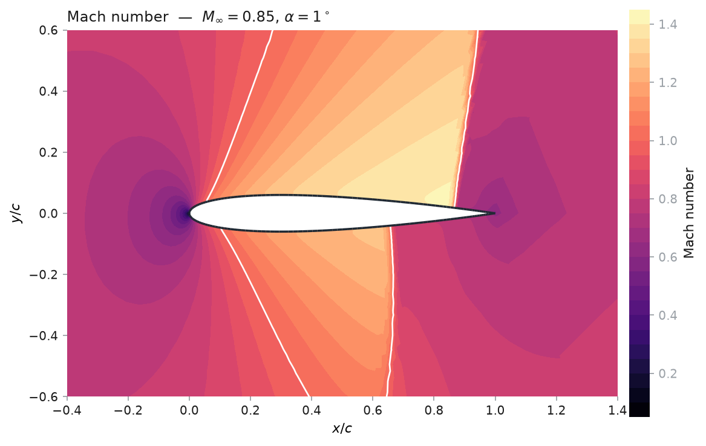
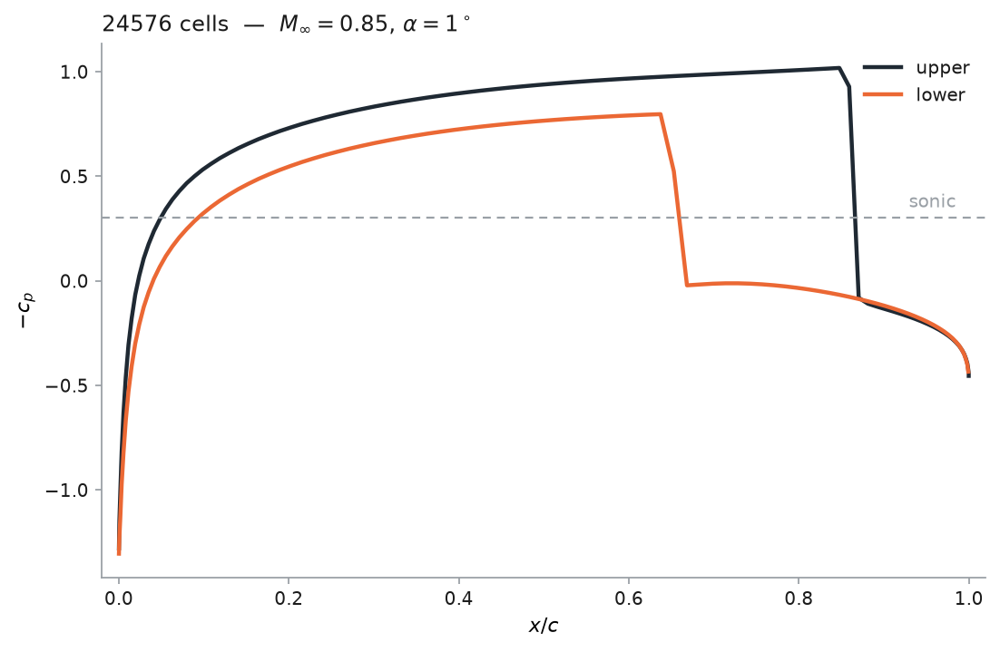

# 2D finite-volume airfoil code

[](docs/)
[](LICENSE)

A 2D finite-volume solver for the compressible Euler equations around an
airfoil, built as a **teaching code for transonic aerodynamics**.

You change the section and the angle of attack, sweep them, and take
sensitivities. You do not write the solver — it is a port of one that already
worked, and the MATLAB it came from is kept in [`legacy/`](legacy/).

```python
from src import solve_airfoil

result = solve_airfoil("0012", mach=0.8, alpha=1.25)
print(result.report())
```



*NACA 0012 at $M_\infty = 0.85$, $\alpha = 1^\circ$. The free stream is
subsonic; the flow over the section is not. The white line is sonic, and each
pocket ends in a **shock** — the near-vertical fronts at 86% chord above and 66%
below, where the flow jumps back to subsonic in the width of a cell or two.
Peak Mach 1.41, $c_\ell = 0.334$, $c_d = 0.068$.*

> **All five increments are done.** The solver runs, converges and is verified;
> the compiled backend, the discrete adjoint and adaptive refinement are in, and
> [`docs/lab.md`](docs/lab.md) is the exercise set built on them.
> [`docs/roadmap.md`](docs/roadmap.md) records what each increment changed, and
> what was deliberately left out.

---

## Quick start

You need Python 3.10+ and NumPy. There is no install step and nothing to
compile.

```bash
git clone https://github.com/mrodrig6/2D_airfoil.git
cd 2D_airfoil
./fv2d.sh check                       # what is available
./fv2d.sh mesh @grid figure=mesh.png
```

`check` reports a `NO` for each optional piece you are missing; `./fv2d.sh
install` adds them all. The other commands available today:

```bash
./fv2d.sh geometry airfoil=23012 figure=section.png normals=yes
./fv2d.sh geometry airfoil=my_design.dat     # anything XFOIL wrote
./fv2d.sh mesh topology=cgrid @transonic     # a C-grid instead
./fv2d.sh flow mach=0.8 alpha=1.25           # the non-dimensional free stream
./fv2d.sh mesh mesh=external.su2             # a mesh from somewhere else
./fv2d.sh solve @transonic cp=cp.png         # solve, and plot the pressure
./fv2d.sh sweep @subcritical alphas=-4:8:2   # a polar from one mesh
./fv2d.sh sensitivity @subcritical           # exact gradients, one adjoint
./fv2d.sh adapt @transonic cycles=6          # refine where the error is
```

Four worked scripts live in [`examples/`](examples/) — one operating point, an
angle-of-attack sweep, adjoint gradients, and a shape optimisation driven by
them. Each runs with no arguments:

```bash
python examples/01_solve.py
```

### Checking it still works

There is **no CI** — nothing runs on push, and no service decides whether a
change is good. You do, on your own machine:

```bash
./fv2d.sh verify            # tests, lint, format, spelling
./fv2d.sh verify --fast     # same, minus the full-size meshes
./fv2d.sh test tests/test_mesh.py -k normal
```

`verify` skips any step whose tool is not installed and says so, rather than
failing — a missing linter is not a broken solver. It exits non-zero if anything
that did run failed.

→ Full launcher reference and the Python API: **[`docs/usage.md`](docs/usage.md)**

---

## What it does

**Describes a section.** The NACA **four- and five-digit** families generated
analytically, or coordinates read from a file — Selig or Lednicer, which is
what XFOIL and every airfoil database write. An externally designed section is
a first-class input, not a special case.
→ [`docs/theory.md`](docs/theory.md#airfoil-geometry)

**Meshes it, two ways.** A body-fitted **O-grid** — wall-orthogonal at the
surface, landing exactly on a circular far field — or a **C-grid**, which cuts
along the wake so cells behind the trailing edge run *with* it instead of
fanning out of it. Both split into triangles, and the solver sees only the
triangles, so the topology is one option. The MATLAB this replaces had no
mesher — it called the PDE Toolbox — so this is the one genuinely new part of
the port. → [`docs/theory.md`](docs/theory.md#mesh-generation)

**Reads someone else's mesh.** SU2 and Gmsh 2.2, with the boundary markers
mapped onto this code's two boundary conditions, and a loud refusal rather than
a silent one when a marker cannot be mapped.
→ [`docs/usage.md`](docs/usage.md#using-a-mesh-from-elsewhere)

**Solves.** Cell-centred finite volume on triangles, marched to steady state
with a local time step. Three approximate Riemann solvers supply the upwinding —
Roe with the Harten–Hyman entropy fix, HLLC with Batten's wave speeds, and
AUSM⁺-up, which splits the flux rather than decomposing the jump into waves. A
fourth, SLAU2, was implemented, measured over 60 solves and removed; the
measurement is [kept](docs/riemann_fluxes.md) even though the code is not —
along with the retraction of a conclusion about AUSM⁺-up that turned out to be
about a bug in its implementation rather than about the scheme.
→ [`docs/theory.md`](docs/theory.md#6-the-finite-volume-discretisation)

**Says what the answer is.** Surface pressure, field contours, and the loads
against incidence, each one command or one function call.
→ [`examples/06_postprocess.py`](examples/06_postprocess.py) draws all three

| | |
|---|---|
|  |  |
| The same two shocks, seen as pressure: `./fv2d.sh solve naca=0012 mach=0.85 alpha=1 cp=cp.png` | `./fv2d.sh sweep @subcritical alphas=-4:8:2 figure=polar.png` |

**Runs fast.** A compiled Numba backend with the whole march fused into one
`nopython` call — **23× the vectorised reference** on the production mesh, and a
converged transonic solve in 16 seconds rather than six minutes. The answer does
not depend on which backend ran.
→ [`docs/performance.md`](docs/performance.md)

**Takes exact design gradients.** The derivative of lift, drag or moment with
respect to the angle of attack, the Mach number or the shape, by the **discrete
adjoint** — one adjoint solve regardless of how many design variables there are,
with both Jacobian actions from `jax.vjp` on the same residual the solver
marches, so the gradient follows the scheme with nothing re-derived by hand.
Checked against finite differences — the incidence derivative agrees in the
eighth significant figure — and driving a two-variable inverse design to its
target in eight flow solves.
→ [`docs/workflows.md`](docs/workflows.md#exact-design-gradients)

**Refines where the error is.** The legacy's Mach-jump indicator, unchanged,
driving conforming red–green refinement with new boundary nodes projected back
onto the section — so refining the wall makes the airfoil rounder rather than
just adding points on its chords. Green closure is regenerated from a tree of
red subdivisions every cycle, which is what stops repeated refinement producing
slivers. Whether it actually pays on this case is
[measured rather than asserted](docs/adaptation.md#does-it-pay), and the answer
is more interesting than the textbook one.
→ [`docs/adaptation.md`](docs/adaptation.md)

**Is non-dimensional throughout.** No SI anywhere: ρ∞ = |v∞| = c = 1 and
R = γ − 1, so dynamic pressure is exactly 1/2 at every operating point and force
coefficients compare across Mach numbers without rescaling.
→ [`docs/theory.md`](docs/theory.md#non-dimensionalisation)

---

## Where to read next

| If you want to | Read |
|---|---|
| Drive the code — launcher, Python API, every option | [`docs/usage.md`](docs/usage.md) |
| Sweep, take sensitivities, optimise a shape | [`docs/workflows.md`](docs/workflows.md) |
| Understand the formulation — equations, non-dimensionalisation, geometry, mesh, scheme | [`docs/theory.md`](docs/theory.md) |
| Know whether to believe a result | [`docs/verification.md`](docs/verification.md) |
| Know how fast it is, and why | [`docs/performance.md`](docs/performance.md) |
| See which flux to use, and why | [`docs/riemann_fluxes.md`](docs/riemann_fluxes.md) |
| Work through it as a course | [`docs/lab.md`](docs/lab.md) |
| Find your way around the source, or add to it | [`src/hierarchy.md`](src/hierarchy.md) |
| Refine a mesh where the solution needs it | [`docs/adaptation.md`](docs/adaptation.md) |
| Know what is built and what is not | [`docs/roadmap.md`](docs/roadmap.md) |
| See the MATLAB this came from, and what the port changed | [`legacy/README.md`](legacy/README.md) |

---

## Assumptions and constraints

Every result from this code will be conditional on the following. None is a bug
or a gap to be filled later; they are the modelling choices that define what the
solver *is*.

| | Assumption | Consequence |
|---|---|---|
| 1 | **Inviscid.** The Euler equations — no viscosity, no boundary layer | No skin friction, no separation. Transonic drag here is **wave drag only**, and comparing it to a measured drag is comparing two different quantities |
| 2 | **Calorically perfect gas**, constant γ = 1.4 | Fine for the whole transonic range this code targets |
| 3 | **Steady** | Marched in pseudo-time to a fixed point. Buffet and any other unsteady transonic phenomenon is outside the model, not merely unresolved |
| 4 | **Two-dimensional**, unit span | A section, not a wing. No induced drag, and no three-dimensional relief of the shock |
| 5 | **First-order accurate.** Piecewise-constant reconstruction, as the legacy had | Lift is within a few per cent; **drag is not usable** — the spurious drag at a point where it must be zero is 0.013 against a published transonic wave drag of 0.022. [Measured](docs/verification.md#spurious-drag-and-what-first-order-costs) |
| 6 | **Sharp trailing edge, no Kutta condition imposed** | Circulation is set by the discretisation at the trailing edge rather than by an explicit condition — which is standard for an Euler solver, and is the reason trailing-edge resolution affects lift |
| 7 | **Non-dimensional throughout** | No SI anywhere. Compare runs with `cl` and `cd`, not raw forces |
| 8 | **The mesh is structured** | Resolution is set by `n_surface` and `n_radial`, not by an error indicator, so a shock is resolved by whatever the grid provides there. Both an O-grid and a C-grid are available — see [`docs/theory.md`](docs/theory.md#choosing-a-topology) |

---

## Licence

This project is licensed under the MIT License — see the [`LICENSE`](LICENSE)
file for details.

Copyright (c) 2026 Mauro Rodriguez
