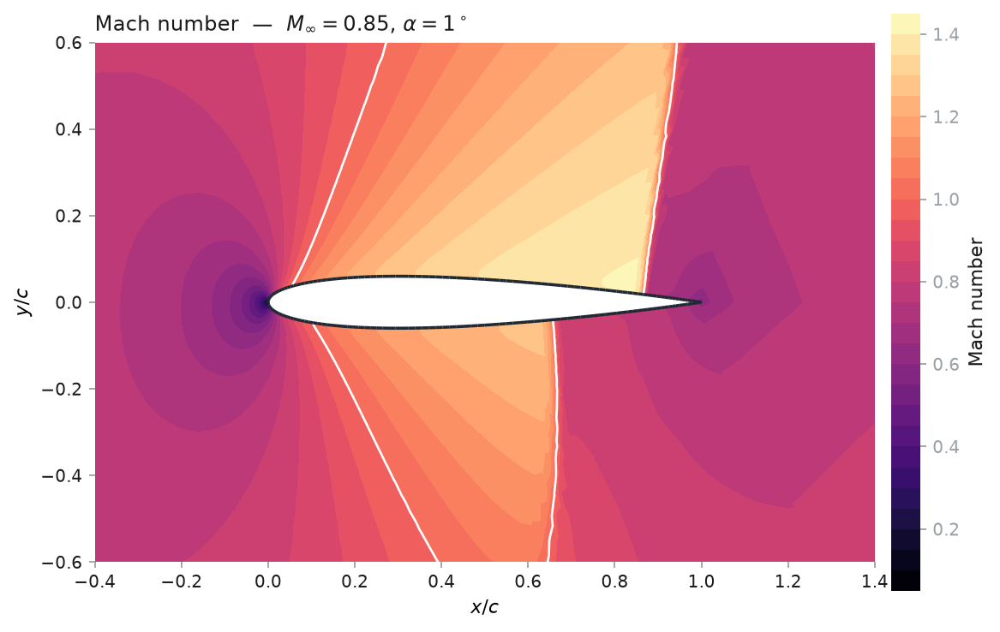

# 2D finite-volume airfoil solver

[](https://github.com/mrodrig6/2D_airfoil/actions/workflows/tests.yml) [](https://github.com/mrodrig6/2D_airfoil/actions/workflows/docs.yml) [](https://github.com/mrodrig6/2D_airfoil/actions/workflows/lint.yml) [](https://github.com/mrodrig6/2D_airfoil/actions/workflows/format.yml) [](https://github.com/mrodrig6/2D_airfoil/actions/workflows/spelling.yml) [](LICENSE)

This Python solver computes steady compressible Euler flow around an airfoil section. Use it for transonic aerodynamics studies: change the section or angle of attack, inspect shocks and loads, and compare design sensitivities.



- Generate four- and five-digit NACA sections or read coordinate files.
- Build O- or C-grids and import triangular SU2 or Gmsh meshes.
- Compute surface pressure, lift, drag and moment with a first-order finite-volume scheme.
- Sweep incidence, compute adjoint gradients, optimize camber, and adapt the mesh.

Add custom geometry or numerical components through the [documented extension points](docs/api/extending.md).

## Install

From this checkout with Python **3.10 or newer**:

```bash
python -m pip install -e ".[all]"
```

Full instructions, including isolated environments and developer tools: [installation](docs/getting-started/installation.md).

## Quick start

```bash
# Check installed dependencies and backends.
./airfoil.sh check
# Inspect a section.
./airfoil.sh geometry airfoil=2412
# Build and plot the legacy mesh.
./airfoil.sh mesh cases/grid.json figure=mesh.png
# Solve the small case and save surface pressure.
./airfoil.sh run cases/coarse.json cp=cp.png
# Compute an incidence sweep on the small mesh.
./airfoil.sh sweep cases/coarse.json alphas=-2:2:2 figure=polar.png
```

```python
from src import solve_airfoil

result = solve_airfoil(
    "0012",
    mach=0.5,
    alpha=2.0,
    n_surface=96,
    n_radial=40,
    far_field_radius=15.0,
    first_cell_height=5e-3,
)
assert result.converged, result.message
print(result.report())
```

Full walkthrough with captured output: [quick start](docs/getting-started/quick-start.md).

## Documentation

| Section | Pages |
|---|---|
| Getting started | [Installation](docs/getting-started/installation.md) · [Quick start](docs/getting-started/quick-start.md) · [Examples](docs/getting-started/examples.md) |
| Running | [Command line](docs/running/command-line.md) · [Configuration](docs/running/configuration.md) · [Solving a case](docs/running/solving.md) · [Reading results](docs/running/output.md) · [Parameter sweeps](docs/running/sweeps.md) · [Sensitivity analysis](docs/running/sensitivity.md) · [Shape optimization](docs/running/optimization.md) · [Troubleshooting](docs/running/troubleshooting.md) · [Airfoil geometry](docs/running/geometry.md) · [Generating meshes](docs/running/meshing.md) · [Importing meshes](docs/running/mesh-import.md) · [Plotting](docs/running/plotting.md) · [Aerodynamics lab](docs/running/lab-guide.md) |
| Python API | [Library usage](docs/api/package.md) · [Extending the solver](docs/api/extending.md) |
| Background / Model | [Problem and assumptions](docs/model/problem.md) · [Parameters](docs/model/parameters.md) · [Units and reference scales](docs/model/units.md) |
| Method | [Spatial discretization](docs/method/discretization.md) · [Numerical fluxes](docs/method/fluxes.md) · [Boundary conditions](docs/method/boundary-conditions.md) · [Backends and performance](docs/method/backends.md) · [Time stepping and convergence](docs/method/time-stepping.md) · [Mesh generation](docs/method/meshing.md) · [Adaptive algorithm](docs/method/adaptation.md) |
| Theory | [Euler equations](docs/theory/euler.md) · [Discrete adjoint](docs/theory/adjoint.md) · [Airfoil geometry](docs/theory/airfoil-geometry.md) |
| Validation | [Test-suite claims](docs/validation/tests.md) · [Gradient comparisons](docs/validation/gradients.md) · [Legacy geometry](docs/validation/legacy-geometry.md) · [Thin-airfoil lift](docs/validation/thin-airfoil.md) · [Transonic NACA 0012](docs/validation/transonic.md) · [Numerical drag and pressure error](docs/validation/numerical-drag.md) · [Far-field sensitivity](docs/validation/far-field.md) · [Flux study](docs/validation/flux-study.md) · [Adaptation versus uniform refinement](docs/validation/adaptation.md) · [Legacy force integral](docs/validation/legacy-forces.md) |
| Reference | [Compatibility](docs/reference/compatibility.md) · [Code map](docs/reference/code-map.md) · [Repository map](docs/reference/repository.md) · [Continuous integration](docs/reference/ci.md) · [Figures](docs/reference/figures.md) · [Bibliography](docs/reference/bibliography.md) · [Development history](docs/reference/history.md) · [MATLAB provenance](docs/reference/legacy.md) |

A Python port of Mauro Rodriguez's MATLAB teaching code, whose original is kept in [legacy/](legacy/README.md). To cite the methods, see the [bibliography](docs/reference/bibliography.md); a citation for the project itself is not yet specified.

## License

[MIT](LICENSE). Copyright © 2026 Mauro Rodriguez.
