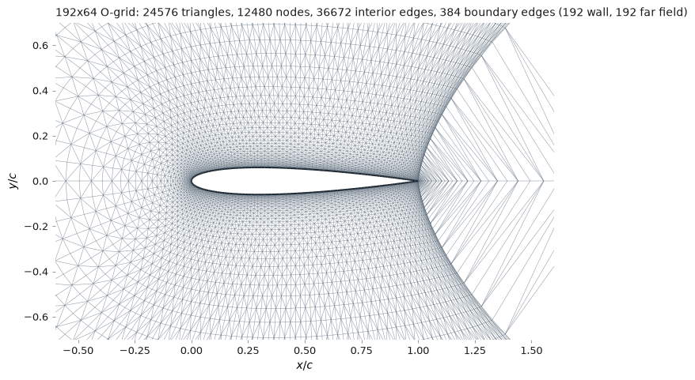

# 2D finite-volume airfoil code

[](docs/)
[](LICENSE)

A 2D finite-volume solver for the compressible Euler equations around an
airfoil, built as a **teaching code for transonic aerodynamics**.

You change the section and the angle of attack, sweep them, and take
sensitivities. You do not write the solver — it is a port of one that already
worked, and the MATLAB it came from is kept in [`legacy/`](legacy/).

```python
from src import naca4, build_mesh

mesh, grid = build_mesh(naca4("0012", 192))
print(mesh.summary())
```



> **This is the first of five increments and it does not solve anything yet.**
> Geometry and meshing are complete and tested; the solver, the backends and the
> adjoint arrive next. [`docs/roadmap.md`](docs/roadmap.md) says what lands when.

---

## Quick start

You need Python 3.10+ and NumPy. There is no install step and nothing to
compile.

```bash
git clone https://github.com/mrodrig6/2D_airfoil.git
cd 2D_airfoil
./fv2d.sh check                       # what is available
./fv2d.sh mesh @transonic figure=mesh.png
```

`check` reports a `NO` for each optional piece you are missing; `./fv2d.sh
install` adds them all. The other commands available today:

```bash
./fv2d.sh geometry airfoil=2412 figure=section.png normals=yes
./fv2d.sh geometry airfoil=my_design.dat     # anything XFOIL wrote
./fv2d.sh flow mach=0.8 alpha=1.25           # the non-dimensional free stream
./fv2d.sh mesh mesh=external.su2             # a mesh from somewhere else
```

### Checking it still works

There is **no CI** — nothing runs on push, and no service decides whether a
change is good. You do, on your own machine:

```bash
./fv2d.sh verify            # tests, lint, format, spelling
./fv2d.sh verify --fast     # same, minus the full-size meshes
./fv2d.sh test tests/test_mesh.py -k normal
```

`verify` skips any step whose tool is not installed and says so, rather than
failing — a missing linter is not a broken solver. It exits non-zero if anything
that did run failed.

→ Full launcher reference and the Python API: **[`docs/usage.md`](docs/usage.md)**

---

## What it does

**Describes a section.** The NACA four-digit family generated analytically, or
coordinates read from a file — Selig or Lednicer, which is what XFOIL and every
airfoil database write. An externally designed section is a first-class input,
not a special case. → [`docs/theory.md`](docs/theory.md#airfoil-geometry)

**Meshes it.** A body-fitted O-grid, wall-orthogonal at the surface and landing
exactly on a circular far field, split into triangles. The MATLAB this replaces
had no mesher — it called the PDE Toolbox — so this is the one genuinely new
part of the port. → [`docs/theory.md`](docs/theory.md#mesh-generation)

**Reads someone else's mesh.** SU2 and Gmsh 2.2, with the boundary markers
mapped onto this code's two boundary conditions, and a loud refusal rather than
a silent one when a marker cannot be mapped.
→ [`docs/usage.md`](docs/usage.md#using-a-mesh-from-elsewhere)

**Is non-dimensional throughout.** No SI anywhere: ρ∞ = |v∞| = c = 1 and
R = γ − 1, so dynamic pressure is exactly 1/2 at every operating point and force
coefficients compare across Mach numbers without rescaling.
→ [`docs/theory.md`](docs/theory.md#non-dimensionalisation)

---

## Where to read next

| If you want to | Read |
|---|---|
| Drive the code — launcher, Python API, every option | [`docs/usage.md`](docs/usage.md) |
| Understand the formulation — equations, non-dimensionalisation, geometry, the mesh | [`docs/theory.md`](docs/theory.md) |
| Know what is built and what is not | [`docs/roadmap.md`](docs/roadmap.md) |
| See the MATLAB this came from, and what the port changed | [`legacy/README.md`](legacy/README.md) |

---

## Assumptions and constraints

Every result from this code will be conditional on the following. None is a bug
or a gap to be filled later; they are the modelling choices that define what the
solver *is*.

| | Assumption | Consequence |
|---|---|---|
| 1 | **Inviscid.** The Euler equations — no viscosity, no boundary layer | No skin friction, no separation. Transonic drag here is **wave drag only**, and comparing it to a measured drag is comparing two different quantities |
| 2 | **Calorically perfect gas**, constant γ = 1.4 | Fine for the whole transonic range this code targets |
| 3 | **Steady** | Marched in pseudo-time to a fixed point. Buffet and any other unsteady transonic phenomenon is outside the model, not merely unresolved |
| 4 | **Two-dimensional**, unit span | A section, not a wing. No induced drag, and no three-dimensional relief of the shock |
| 5 | **Sharp trailing edge, no Kutta condition imposed** | Circulation is set by the discretisation at the trailing edge rather than by an explicit condition — which is standard for an Euler solver, and is the reason trailing-edge resolution affects lift |
| 6 | **Non-dimensional throughout** | No SI anywhere. Compare runs with `cl` and `cd`, not raw forces |
| 7 | **O-grid topology** | The wake is not wrapped by the grid the way a C-grid would wrap it, so cells downstream of the trailing edge are stretched. For an inviscid solve this costs far less than it would with viscosity, but it is a real limitation — see [`docs/theory.md`](docs/theory.md#limitations-of-the-o-grid) |

---

## Licence

This project is licensed under the MIT License — see the [`LICENSE`](LICENSE)
file for details.

Copyright (c) 2026 Mauro Rodriguez
