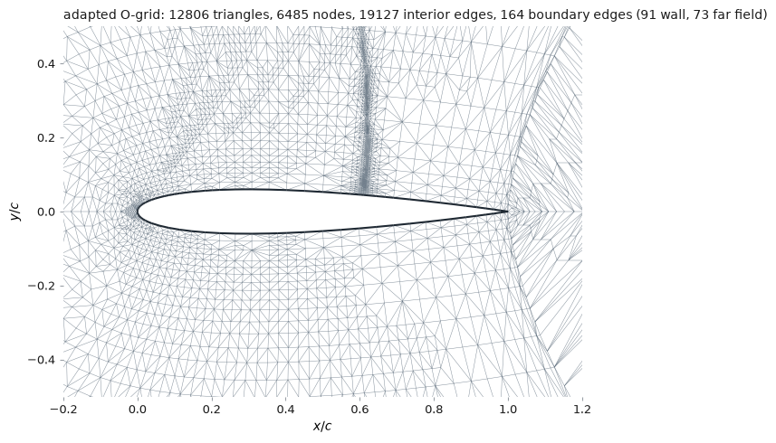

# Adaptive refinement

A uniformly finer mesh refines the far field — where nothing is happening — as
hard as it refines the shock. Adaptation spends the cells where the solution is
changing instead. This document is what the implementation does, why each piece
is the way it is, and whether it actually pays on this problem.



*Six cycles from a 64×24 O-grid, 3 072 cells to 12 806. Nobody told the
indicator where the shock was.*

## Contents

- [The indicator is the legacy's](#the-indicator-is-the-legacys)
- [Red, green, and the trap](#red-green-and-the-trap)
- [New boundary nodes go on the geometry](#new-boundary-nodes-go-on-the-geometry)
- [Carrying the solution across](#carrying-the-solution-across)
- [Does it pay?](#does-it-pay)
- [What would change the answer](#what-would-change-the-answer)
- [Using it](#using-it)

---

## The indicator is the legacy's

`legacy/post_calc.m` scores each element by the jump in Mach number across its
faces, weighted by face length:

$$
\varepsilon_e = \sum_{f \in \text{interior}} |M_e - M_{e'}|\,\ell_f
\;+\; \sum_{f \in \text{wall}} |M_n|\,\ell_f
$$

`src/spatial/adapt.py` reproduces it exactly, including the second term, and refines the
worst 5% of elements per cycle — the same `f = 0.05`.

**The second term is not a jump**, and it is the more interesting half. The wall
condition says the normal velocity vanishes, so whatever normal Mach number
survives at a wall face is the solution disobeying its own boundary condition.
That term flags the leading edge and the trailing edge without anyone naming
them, which is why the refinement in the figures is not only at the shock.

**It is a quantity with the dimensions of a length, not a density.** Two cells of
very different size are therefore not compared fairly: a big cell can out-score a
small one simply by having longer faces. That is the legacy's choice and it is
kept, partly because it is self-limiting — refining a cell halves its faces, so
it stops being flagged once it is small enough — and partly because it turns out
to matter for the result below.

## Red, green, and the trap

A flagged triangle is cut into four by joining its edge midpoints: a **red**
refinement. The four children are similar to the parent, so red refinement can be
applied forever without changing the shape of anything.

The neighbour across a refined edge now has a **hanging node** in the middle of
one of its edges, and the solver has no concept of one — every face must have
exactly one element on each side, or the flux is not conservative. The hanging
node is removed by bisecting that neighbour from the opposite vertex: a **green**
closure.

**Green triangles are the trap.** They are not similar to their parent — the
bisection splits the angle at the opposite vertex — so bisecting a green triangle
again, and again, drives the smallest angle towards zero. The cells become
slivers, the local time step collapses with them, and the march slows to a halt
long after anyone has stopped suspecting the mesh.

This implementation makes that impossible rather than guarding against it. It
stores only the **tree of red subdivisions**; green closure is a rendering step,
recomputed from the current leaves every time a mesh is built and thrown away
afterwards. A green triangle is therefore never refined, because it never exists
between cycles. The tree also enforces **one-irregularity** — two triangles
sharing an edge differ by at most one level — so a face is split at most once and
a single bisection always closes it.

Measured over eight cycles on the transonic case, the smallest angle in the mesh
goes 4.89° → 4.56° → … → 4.07°: it pays for the first green closure once and then
stops falling. A naive implementation halves it every cycle.

## New boundary nodes go on the geometry

The midpoint of a wall face lies on the straight line between two surface points,
which is *inside* the airfoil. Leave it there and the section never gets rounder
however fine the mesh becomes — the mesh converges to a polygon, not to the
airfoil, and the leading edge, where the indicator is loudest, converges to the
wrong shape.

Every new wall node is therefore projected onto the section, and every new
far-field node onto the far-field circle. The section used for the projection is
regenerated analytically when the name is a NACA code, and densified by the same
Hermite interpolation `resample` uses when it is not — for a section read from a
file there is no analytic curve to recover.

The test for this is global rather than per-node: the area enclosed by the
refined wall polygon must be **larger** than the coarse one and no larger than
the section's true area. On a 48-point NACA 0012: 0.081473 coarse, 0.081647
refined, 0.081706 true.

## Carrying the solution across

Each child inherits its parent's cell average. For a piecewise-constant scheme
that is the exact projection onto the new mesh — a finer mesh holds no
information the coarse solution did not have — and it means each cycle starts
most of the way to its answer.

It saves less than it first appears. The second cycle converges in 2 600
iterations against the first's 5 075, but the sixth needs 55 900, because each
cycle makes the smallest cell smaller and an explicit march is paced by its
smallest cell. **Adaptation buys accuracy per cell, not accuracy per second**,
and those are different claims.

## Does it pay?

The honest answer is **it depends which number you want**, and that is more
useful than the textbook one.

NACA 0012 at $M = 0.8$, $\alpha = 1.25^\circ$, far field at 10 chords. Adaptation
starts from the 64×24 mesh in the first row and refines 5% of cells per cycle;
the uniform column is the same case on progressively finer O-grids. Compare the
two **at equal cell count**, which is the only comparison that answers the
question:

| cells | uniform $c_\ell$ | adaptive $c_\ell$ | uniform $c_d$ | adaptive $c_d$ |
|---|---|---|---|---|
| ~3 100 | 0.26465 | 0.26465 | 0.04915 | 0.04915 |
| ~5 200–6 100 | 0.27924 | 0.28667 | 0.04256 | 0.04396 |
| ~8 960–9 430 | 0.28370 | 0.28230 | 0.04042 | 0.03728 |
| ~12 300–12 800 | 0.28748 | 0.28721 | 0.03894 | 0.03567 |
| ~17 100–17 900 | 0.29149 | 0.28944 | 0.03723 | 0.03436 |
| ~23 000–24 600 | 0.29317 | 0.29200 | 0.03613 | 0.03196 |

**On drag, adaptation wins clearly.** At 23 000 cells it gives $c_d = 0.0320$,
which the uniform sequence does not reach at 24 600 and, extrapolating its own
trend, would need roughly **three times as many cells** to reach. Spurious drag
at this order comes from numerical entropy generated at the shock and the
leading edge, which is exactly where the indicator refines.

**On lift, it does not.** The two agree to within 0.4% the whole way, with
uniform marginally ahead at the top of the table. Lift is a pressure integral
over the whole surface, so it wants the *entire* section resolved — which is
what uniform refinement does and what a 5%-of-cells indicator declines to do.

**Per second, uniform wins outright on this problem.** The last adaptive cycle
takes 66 875 iterations to converge against the uniform mesh's 17 700 at the
same size, because the adapted mesh's smallest cell is an order of magnitude
smaller and an explicit march is paced by it. Multiply cells by iterations and
adaptation costs about four times the work for the same mesh.

So: adaptation here buys **drag accuracy per cell**, pays for it in iterations,
and does nothing for lift. None of that is a defect in the implementation — it is
what this indicator, on this functional, with an explicit solver, actually does.

## What would change the answer

Three things, in increasing order of interest:

1. **An implicit or multigrid solver.** The iteration penalty is entirely the
   explicit march's smallest cell. It is the reason adaptation is almost always
   paired with implicit time stepping in production codes.
2. **An area-normalised indicator.** $\varepsilon_e$ has the dimensions of a
   length, so large cells are flattered. Dividing by the cell's perimeter, or by
   its area, changes which cells are flagged — try it; the code is four lines in
   `mach_jump_indicator`.
3. **A goal-oriented indicator.** Nothing in a Mach jump knows which functional
   is being computed, which is precisely why it helps drag and not lift. The
   adjoint-weighted residual $|\lambda_e^{T} R_e|$ is the error in *the chosen
   objective* contributed by each cell, and `sensitivity.py` already solves the
   $\lambda$ it needs. That is the piece this repository is best placed to add
   next, and the one that would most change the table above.

## Using it

```bash
./fv2d.sh adapt @transonic cycles=6 figure=adapted.png history=loads.png
./fv2d.sh adapt @transonic cycles=8 fraction=0.10 max_iterations=200000
```

```python
from src import Discretization, FlowConditions, SolverOptions
from src.spatial.adapt import adaptive_solve

history = adaptive_solve(
    "0012",
    Discretization(n_surface=64, n_radial=24, far_field_radius=10.0, first_cell_height=0.02),
    FlowConditions(mach=0.8, alpha_deg=1.25),
    SolverOptions(tolerance=1e-6, max_iterations=80_000, print_interval=0),
    cycles=6,
)
print(history.table())
print(history.final.loads.summary())
```

If the march runs out of iterations, the loop **stops and returns what it has**
with `history.stalled` set, rather than refining a mesh from a solution that
never converged — the cycles already done are good, and the limit is one option
away from being raised.

→ [`../examples/05_adapt.py`](../examples/05_adapt.py) runs both sides of the
table above. [`lab.md`](lab.md#lab-6--spending-cells-where-they-matter) is the
exercise built on it.
