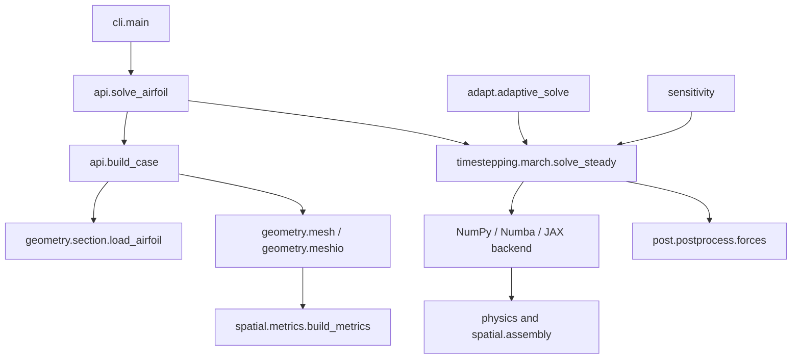

# Code map

The source is grouped by responsibility. The [dependency hierarchy](../../src/hierarchy.md) gives the import rules and self-check commands.

## Module reference

| Module | Responsibility | Main functions / classes |
|---|---|---|
| `config` | Flow, mesh and solver options | `FlowConditions`, `Discretization`, `SolverOptions` |
| `geometry.section` | Section coordinates | `Airfoil`, `naca4`, `naca5`, `load_airfoil` |
| `geometry.mesh` | Mesh topology and construction | `MeshTopology`, `build_mesh` |
| `geometry.meshio` | External mesh files | `read_mesh`, `write_su2` |
| `physics.thermo` | States and ideal-gas relations | `primitives`, `conservative`, `euler_flux` |
| `physics.fluxes` | Interface Riemann solvers | `roe_flux`, `hllc_flux`, `ausmup_flux`, `interface_flux` |
| `physics.boundary` | Wall and far-field conditions | `wall_flux`, `farfield_flux` |
| `spatial.metrics` | Cell and face geometry | `Metrics`, `build_metrics` |
| `spatial.assembly` | Finite-volume residual | `residual` |
| `timestepping.step` | Local timestep and convergence norm | `recommended_cfl`, `local_time_step`, `residual_norm` |
| `timestepping.march` | Steady-state driver | `SolveResult`, `solve_steady` |
| `backends.base` | Shared forward-Euler integrator | `Backend` |
| `backends` | NumPy, Numba and JAX execution | `get_backend`, `available_backends` |
| `post.postprocess` | Loads and derived fields | `forces`, `surface_pressure`, `report` |
| `post.plotting` | Optional figures | `plot_field`, `plot_surface_pressure` |
| `api` | Prepared cases and high-level solves | `Case`, `build_case`, `solve_airfoil` |
| `sensitivity` | Discrete adjoint gradients | `DifferentiableCase`, `four_digit_case` |
| `adapt` | Adaptive solve cycles | `adaptive_solve` |

