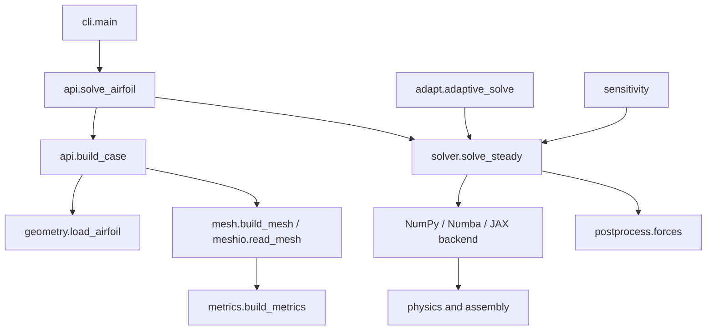

# Code map

This map lists module responsibilities and entry points. Read the diagram as the direction of a normal solve.

## Module reference

| Module | Responsibility | Main functions / classes |
|---|---|---|

