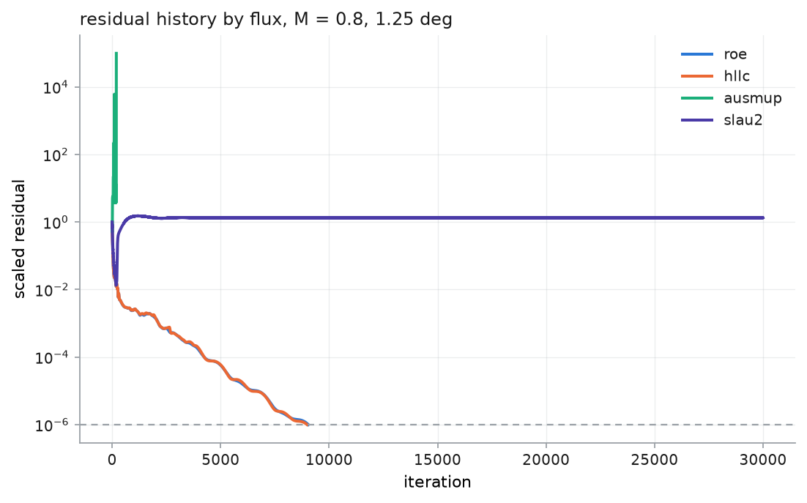

# The approximate Riemann solvers, measured

Four interface fluxes ship, and this is the record of what each one actually
does on this problem. It exists because the companion nozzle code measured the
same four, reached a conclusion, and **said explicitly that the conclusion
should not be carried across** — so it was re-measured rather than inherited.

> **Status: increment 2.** Everything below is measured on one section at two
> operating points on one mesh. The ranking is already clear and the mechanism
> behind the AUSM-family failure is not. The remaining work — mesh dependence,
> the hypotheses in [Open questions](#open-questions), and the shock-resolution
> comparison — is increment 5. See [`roadmap.md`](roadmap.md).

## Contents

- [The question, and why it had to be asked again](#the-question-and-why-it-had-to-be-asked-again)
- [First: are the implementations right?](#first-are-the-implementations-right)
- [The result](#the-result)
- [Do the ones that converge agree?](#do-the-ones-that-converge-agree)
- [AUSM⁺-up has a narrow window, and it is not where Liou says](#ausm-up-has-a-narrow-window-and-it-is-not-where-liou-says)
- [SLAU2 reproduces the nozzle's limit cycle exactly](#slau2-reproduces-the-nozzles-limit-cycle-exactly)
- [What this does and does not establish](#what-this-does-and-does-not-establish)
- [Open questions](#open-questions)
- [Recommendation](#recommendation)

---

## The question, and why it had to be asked again

The nozzle code found Roe-with-entropy-fix and HLLC converged, while AUSM⁺-up
and SLAU2 reached nearly the right answer and then sat in a bounded limit cycle
whose residual never decayed. Six mechanisms were tested there and all six were
refuted; the cause was never identified.

Its `legacy/README.md` then said why that result might not generalise:

> The airfoil problem has a **shock on the body surface**. This nozzle solver
> does not… That difference is not a detail — it inverts which flux is the right
> choice… **So do not carry this project's conclusion across.** […] Carry the
> measurement and the reasoning; re-measure the conclusion.

The reasoning behind that expectation is sound and worth restating, because it
is what makes the result below interesting. Kitamura's 2016 assessment scores
twelve fluxes on the standard 1.5D carbuncle test — robustness at a **captured
strong shock**:

| flux | shock-robustness score | captured shock |
|---|---|---|
| **Roe (entropy fix)** | **0** | thin |
| Roe | 8 | thin |
| **HLLC** | **8** | thin |
| AUSM⁺-up | 16 | thin |
| van Leer FVS | 20 | broad |
| **SLAU2** | **20** | broad |

In the nozzle the ranking came out exactly inverted: the two that score worst
there converged, and the one that scores best did not. Since the nozzle's domain
is shock-free by construction, the property being scored was never exercised —
so on a problem that *does* have a surface shock, the inversion might reasonably
be expected to run the other way.

**It does not.** This code has the shock, and the ranking is the same as the
nozzle's.

## First: are the implementations right?

Before any conclusion about a *scheme*, the port has to be cleared of being the
problem. A subtly wrong SLAU2 that fails to converge would look exactly like a
scheme that fails to converge, and the conclusion would be worthless.

Two independent checks, and they are the reason the rest of this page can be
read as being about the schemes.

**Against the nozzle's reference implementations.** The companion project's
`legacy/riemann_solvers.py` carries all four fluxes, verified there. Run on 200
random state pairs spanning Mach 0.018 to 8.86, including 289 supersonic faces:

| flux | max relative difference | verdict |
|---|---|---|
| `roe` | 1.2e−16 | identical to round-off |
| `hllc` | 2.5e−16 | identical to round-off |
| `ausmup` | **0** | bit-identical |
| `slau2` | **0** | bit-identical |

**Against the properties a numerical flux must have.** Every solver is checked
for consistency $\hat{F}(U, U, \hat{n}) = F(U)\cdot\hat{n}$, conservation
$\hat{F}(L, R, \hat{n}) = -\hat{F}(R, L, -\hat{n})$, full upwinding in the
supersonic limit, and finiteness at a near-vacuum — all to $10^{-10}$ or better,
in `tests/test_physics.py`. The AUSM split polynomials are checked to sum to
the identities that make the scheme consistent.

**So the failures below are properties of the schemes**, reproduced
independently in two codebases, and not artefacts of this port.

## The result

NACA 0012, $M_\infty = 0.8$, $\alpha = 1.25^\circ$ — a shock at 63% chord on the
upper surface and a weaker one at 38% on the lower. 96 × 40 O-grid, 7 680 cells,
far field 15 chords, CFL 0.9, forward Euler, converged means a scaled residual
below $10^{-6}$.

| flux | converged | $c_\ell$ | $c_d$ | shock $x/c$ | iterations |
|---|---|---|---|---|---|
| **`roe`** | **yes** | +0.2831 | +0.0402 | 0.629 | 9 042 |
| **`hllc`** | **yes** | +0.2743 | +0.0402 | 0.629 | 8 989 |
| `ausmup` | **no** — diverged | — | — | — | 195 |
| `slau2` | **no** — limit cycle | +0.1957 | +0.0423 | 0.533 | 30 000 (stopped) |

Roe and HLLC agree on the shock position to within one cell and on $c_\ell$ to
3%, which is the right order for two different schemes at first order. The two
AUSM-family schemes fail, in two different ways.

## Do the ones that converge agree?

Self-consistency is not "all four give the same answer" — two of them do not
give an answer at all. It is whether the ones that **do** converge agree, and
whether that agreement **improves as the mesh is refined**. If it does, the
spread is discretisation error and the schemes are consistent with each other;
if it does not, something is wrong with one of them.

Roe, HLLC and AUSM⁺-up at $M_{co} = 0.4$, all converged to $10^{-6}$:

| | mesh | cells | `roe` | `hllc` | `ausmup` | $c_\ell$ spread | $c_d$ spread | shock spread |
|---|---|---|---|---|---|---|---|---|
| **subcritical** | 64 × 32 | 4 096 | 0.2406 | 0.2365 | 0.2350 | 2.37% | 17.9% | — |
| $M = 0.5$ | 96 × 40 | 7 680 | 0.2464 | 0.2429 | 0.2421 | 1.74% | 17.1% | — |
| $\alpha = 2^\circ$ | 128 × 48 | 12 288 | 0.2503 | 0.2480 | 0.2478 | **1.03%** | 16.7% | — |
| **transonic** | 64 × 32 | 4 096 | 0.2713 | 0.2624 | 0.2597 | 4.38% | 15.3% | 0.000 |
| $M = 0.8$ | 96 × 40 | 7 680 | 0.2835 | 0.2750 | 0.2713 | 4.42% | 12.0% | 0.032 |
| $\alpha = 1.25^\circ$ | 128 × 48 | 12 288 | 0.2916 | 0.2829 | 0.2808 | **3.78%** | 10.5% | 0.000 |

Three things to read off it.

**Lift agreement tightens with refinement** — 2.4% to 1.0% subcritical, 4.4% to
3.8% transonic — and all three march toward the same limit. Subcritically that
limit is checkable: thin-airfoil theory with the Prandtl–Glauert correction
gives 0.2532, and Roe reaches 0.2503 on the finest mesh. The spread is
discretisation error, behaving as discretisation error should.

**The shock lands in the same place.** All three agree to within one cell on two
of the three meshes, and to 0.03 chord on the third. Three schemes with
completely different derivations putting a shock in the same cell is a strong
statement that none of them is wrong.

**Drag agrees far less well, and that is expected rather than alarming.** At
first order most of the computed $c_d$ *is* the scheme's numerical dissipation
(see [`verification.md`](verification.md#spurious-drag-and-what-first-order-costs)),
and the three schemes differ precisely in how they dissipate. So drag is the
quantity where they must differ most. It is also shrinking — 17.9% to 16.7%
subcritical, 15.3% to 10.5% transonic — which is what it should do if the
difference is dissipation that is itself vanishing with $h$.

## AUSM⁺-up has a narrow window, and it is not where Liou says

The run above used $M_{co} = M_\infty = 0.8$, following Liou's own guidance.
That is what diverged, so the one tunable constant was swept.

| $M_{co}$ | transonic ($M_\infty = 0.8$) | subcritical ($M_\infty = 0.5$) |
|---|---|---|
| 0.02 – 0.20 | **diverges in < 35 iterations** | diverges |
| 0.30 | converged, $c_\ell$ = 0.2672 | converged, $c_\ell$ = 0.2384 |
| 0.35 | converged, 0.2694 | converged, 0.2406 |
| **0.40** | **converged, 0.2713** | **converged, 0.2424** |
| 0.45 | converged, 0.2729 | converged, 0.2439 |
| 0.50 | stalls at 9.5e−2 | stalls at 5.2e−1 |
| 0.80 | diverges at 195 iterations | diverges |

Three things follow, and the third is the surprise.

**The low-$M_{co}$ divergence is the documented trap.** $f_a = M_0(2 - M_0)$
appears as $K_p/f_a$ in the pressure-diffusion term, so driving $M_{co}$ towards
zero makes that coefficient blow up. The nozzle recorded the same failure.

**The high-$M_{co}$ failure is the opposite problem.** As $M_{co} \to 1$,
$f_a \to 1$ and the low-Mach enhancement switches off, recovering plain AUSM⁺ —
which has the well-known pressure–velocity decoupling as $M \to 0$. An airfoil
has a **stagnation point**, so there is always a region at $M \approx 0$ for that
to bite. A nozzle has no stagnation point in its interior, which is plausibly
why the nozzle never saw this end of the failure.

**The window does not move with the free stream.** It is 0.30–0.45 at
$M_\infty = 0.8$ *and* at $M_\infty = 0.5$. Liou's guidance is
$M_{co} \sim M_\infty$, and that would predict the window to shift by a factor
of 1.6 between the two. It does not shift at all. Whatever sets the window here,
it is not the free-stream Mach number — which is consistent with it being set at
the other end of the range, by the stagnation region that both cases share.

The shipped default is therefore **0.4**, measured, not 0.8 inherited.

## SLAU2 reproduces the nozzle's limit cycle exactly

SLAU2 is the interesting one, because it has **no tunable constant at all** —
every switch is built from the states themselves. There is nothing to get wrong,
which is precisely why the nozzle carried it.

It behaves here exactly as it did there: it reaches a plausible answer and then
stops improving. $c_\ell = 0.196$ against Roe's 0.283, the shock at 0.533 against
0.629, an entropy error of the same order as Roe's — close enough to be
recognisable, far enough to be useless — and a residual that sits near $10^{-1}$
for 30 000 iterations without decaying.

That is the same signature, on a domain with the shock the nozzle lacked. The
hypothesis that the shock was the missing ingredient is **not supported**.

### Where the residual actually lives

The nozzle asked this and found the failure *distributed* — its ten worst cells
carried 8.3% of the total, spread through the supersonic section rather than
piled at one feature. Repeating it here, where there is an obvious feature to
pile at, gives a sharper answer than it could:

| region | share of cells | share of residual |
|---|---|---|
| Mach > 1.1 | 4.3% | **60.8%** |
| Mach 0.9 – 1.1 | 12.1% | 36.7% |
| Mach < 0.9 | 83.6% | **2.6%** |
| wall-adjacent cells | 1.2% | 5.6% |
| within 0.06 chord of the shock | 4.8% | 4.3% |

**It is the supersonic pocket, and it is neither the shock nor the wall.** The
worst cells sit at $x/c = 0.26$–$0.41$ just above the upper surface at Mach
1.25–1.29 — upstream of the shock, inside the pocket. The ten worst carry 5.6%,
matching the nozzle's 8.3%, so it is not a handful of bad cells; but the worst
10% carry 99.9% against Roe's 68.6%, so it is strongly regional.

The limit cycle is also far more violent here than in the nozzle: the state
keeps moving with a saturated amplitude of $1.7\times10^{-1}$ relative, against
the nozzle's $8\times10^{-4}$. Measured over 400 further steps after the march
was abandoned, the amplitude in the last 50 equals the amplitude in the first
50 to four digits — saturated, not decaying.

That the failure concentrates in the *supersonic* region, and that it is worse
on a case with a supersonic pocket than on one without, is the most specific
thing either project has about the mechanism. It is still not a demonstration,
and it is written down as [open question 3](#open-questions) rather than a
conclusion.

## What this does and does not establish

**Established.**

* Roe with the Harten–Hyman entropy fix and HLLC both converge on this problem
  and agree with each other.
* AUSM⁺-up converges only inside a narrow $M_{co}$ window, and that window is
  not predicted by Liou's guidance for this geometry.
* SLAU2 does not converge here, with no constant available to blame.
* The nozzle's ranking **transfers** to a problem with a surface shock, which
  that project explicitly expected it might not.

**Not established.**

* *Why*. The mechanism behind the AUSM-family limit cycle is no better
  understood than it was in the nozzle, and nothing here was designed to find
  it.
* Whether the window moves with the mesh, the CFL, or the section. One mesh,
  one section, two operating points.
* Whether a second-order reconstruction changes any of it. Everything here is
  first order; the AUSM family's published advantages are largely about
  *shock capturing*, which first order smears anyway.

**No remedy has been added to the solver.** The two schemes that fail are
shipped failing, with no extra damping, no scheme-specific CFL, and no smoothing
to paper over it — which is what makes this page checkable rather than a story.

## Open questions

For increment 5, written down now so the null results are not lost:

1. **Is the high-$M_{co}$ failure really the stagnation point?** Testable: run
   AUSM⁺-up at $M_{co} = 0.8$ on a case with no stagnation region in the
   interior, or compare the residual's spatial distribution against the
   low-Mach cells.
2. **Does the window depend on the mesh?** If 0.30–0.45 is really set by the
   smallest resolved Mach number, refining the leading edge should move it.
3. **Why the supersonic pocket?** Measured above: Mach > 0.9 is 16% of the
   cells and 97% of SLAU2's residual, while the shock and the wall are
   innocent. The obvious follow-up is whether the pocket's *extent* predicts the
   failure — a sequence of Mach numbers from 0.72 (no pocket) upward would say,
   and it is cheap.
4. **Does second order change the ranking?** The AUSM family's case rests on
   shock capturing. Increment 3 makes this answerable.

## Recommendation

**Use `roe` (the default) or `hllc`.** They converge, they agree, and HLLC needs
no entropy-fix parameter.

`ausmup` is usable at $M_{co}$ near 0.4 and gives an answer within 4% of Roe's,
but the window is narrow enough that it should not be used without checking
convergence. `slau2` does not converge here and is shipped for the comparison,
not for use.

That is the same practical conclusion the nozzle reached. The difference is that
it is now a conclusion for a problem **with** a surface shock, which is the one
the nozzle could not test.
