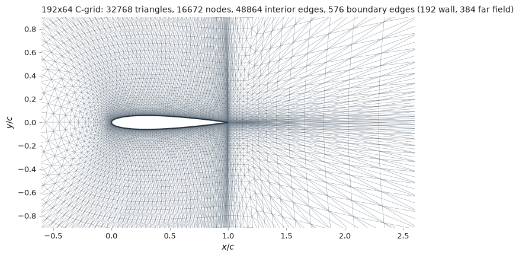

# fvairfoil — formulation, geometry and the mesh

The equations this code solves, the non-dimensional system it solves them in,
how a section is described, and how the mesh around it is built.

Written in Markdown with LaTeX, so it renders on GitHub and there is nothing to
build in order to read it.

> **Status.** Sections 1–5 are complete and are what the code implements today.
> Sections 6–8 describe the discretisation the solver will use and are written
> here because the geometry and the mesh were built *for* them; the code for
> them lands in the next increment. [`roadmap.md`](roadmap.md) is the schedule.

## Contents

1. [Scope and notation](#1-scope-and-notation)
2. [Non-dimensionalisation](#2-non-dimensionalisation)
3. [Governing equations](#3-governing-equations)
4. [Airfoil geometry](#4-airfoil-geometry)
5. [Mesh generation](#5-mesh-generation)
6. [The finite-volume discretisation](#6-the-finite-volume-discretisation)
7. [Boundary conditions](#7-boundary-conditions)
8. [Forces and coefficients](#8-forces-and-coefficients)
9. [References](#9-references)

---

## 1. Scope and notation

The flow is **steady, two-dimensional, inviscid and compressible**, around a
single airfoil section of unit chord at an angle of attack $\alpha$ in a uniform
free stream of Mach number $M_\infty$. The gas is calorically perfect with
constant $\gamma = 1.4$.

| symbol | meaning |
|---|---|
| $\rho$ | density |
| $\vec{v} = (u, v)$ | velocity |
| $p$ | static pressure |
| $E$ | total energy per unit mass |
| $H = E + p/\rho$ | total enthalpy per unit mass |
| $a = \sqrt{\gamma p / \rho}$ | speed of sound |
| $\gamma$ | ratio of specific heats, 1.4 |
| $c$ | chord, the length scale |
| $\hat{n} = (n_x, n_y)$ | unit normal, outward from the cell |
| $\alpha$ | angle of attack, from the chord line, positive nose-up |

A subscript $\infty$ is a free-stream value. The conservative state vector is

$$
\vec{U} = \left(\rho,\ \rho u,\ \rho v,\ \rho E\right)^T .
$$

### A note on what "transonic" costs

At $M_\infty = 0.8$ and $\alpha = 1.25^\circ$ — the operating point the legacy
MATLAB used, and the standard NACA 0012 test case — the flow accelerates past
$M = 1$ over the upper surface and returns to subsonic through a **normal shock**
at roughly mid-chord. Two things follow, and both shape the rest of this
document:

* The problem is **mixed elliptic–hyperbolic**, with the character changing
  across a surface whose position is part of the answer. No change of variables
  removes this; the scheme has to handle both.
* The shock sits **on the body**, where the pressure that makes up the lift is
  read. The accuracy of the force coefficients is therefore inseparable from how
  the shock is captured, which is why the choice of interface flux is a first-
  class question here and not a detail.

---

## 2. Non-dimensionalisation

There is no SI anywhere in this code. Every quantity is referred to the free
stream, with the chord as the length scale, exactly as `legacy/initialstate.m`
did:

$$
\rho_\infty = 1, \qquad |\vec{v}_\infty| = 1, \qquad c = 1,
\qquad R = \gamma - 1 .
$$

Fixing the density and the speed means the free-stream **Mach number is carried
by the pressure**:

$$
M_\infty = \frac{|\vec v_\infty|}{a_\infty}
         = \frac{|\vec v_\infty|}{\sqrt{\gamma p_\infty / \rho_\infty}}
\qquad\Longrightarrow\qquad
\boxed{\ p_\infty = \frac{\rho_\infty}{\gamma}
        \left(\frac{|\vec v_\infty|}{M_\infty}\right)^{2}
      = \frac{1}{\gamma M_\infty^{2}}\ }
$$

so $p_\infty$ is **not** 1. At $M_\infty = 0.8$ it is $1.116071\ldots$, and
$a_\infty = 1/M_\infty = 1.25$.

The free-stream conservative state is then

$$
\vec{U}_\infty = \left(1,\ \cos\alpha,\ \sin\alpha,\
\frac{p_\infty}{\gamma - 1} + \tfrac12\right)^{T} .
$$

### Why this particular choice

Three properties make it the right one for a design study:

1. **Dynamic pressure is exactly $\tfrac12$** at every operating point, since
   $q_\infty = \tfrac12 \rho_\infty |\vec v_\infty|^2$. A force coefficient is
   therefore just twice the force per unit span, and $c_\ell$ at $M = 0.5$ is
   directly comparable with $c_\ell$ at $M = 0.8$ with no rescaling.
2. **The angle of attack enters in exactly one place** — the direction of
   $\vec v_\infty$. The mesh does not rotate with it, so an $\alpha$ sweep reuses
   one mesh and one set of metrics, which is what makes a sweep cheap and an
   $\alpha$ derivative meaningful.
3. **$R = \gamma - 1$ makes $c_v = 1$**, so temperature and internal energy per
   unit mass are numerically equal. This is the same convention the companion
   nozzle code uses, which keeps the two comparable. Nothing in the solver reads
   $R$ — the Euler equations in conservative form do not contain it — so it
   exists only for reporting a temperature.

### Reynolds number does not appear

Despite being a high-speed aerodynamics code, $Re$ is nowhere in it. The Euler
equations are the $Re \to \infty$ *limit*, not a high-$Re$ flow: there is no
length-to-viscosity ratio left to form. A result from this code is independent
of Reynolds number by construction, which is a modelling statement, not a
convenience.

`src/config.py` holds all of this, and `tests/test_flow.py` checks every claim
above rather than taking it on trust.

---

## 3. Governing equations

The two-dimensional Euler equations in conservative form:

$$
\frac{\partial \vec{U}}{\partial t}
+ \frac{\partial \vec{F}(\vec{U})}{\partial x}
+ \frac{\partial \vec{G}(\vec{U})}{\partial y} = \vec{0},
$$

$$
\vec{U} = \begin{pmatrix} \rho \\ \rho u \\ \rho v \\ \rho E \end{pmatrix},
\qquad
\vec{F} = \begin{pmatrix} \rho u \\ \rho u^2 + p \\ \rho u v \\ \rho u H \end{pmatrix},
\qquad
\vec{G} = \begin{pmatrix} \rho v \\ \rho u v \\ \rho v^2 + p \\ \rho v H \end{pmatrix},
$$

closed by the perfect-gas relation

$$
p = (\gamma - 1)\left(\rho E - \tfrac12 \rho\,(u^2 + v^2)\right),
\qquad H = \frac{\rho E + p}{\rho} .
$$

### The projected flux, and why only it is ever needed

A finite-volume scheme never needs $\vec F$ and $\vec G$ separately — only their
projection onto a face normal. With $v_n = u n_x + v n_y$,

$$
\vec{F}\,n_x + \vec{G}\,n_y
= \begin{pmatrix}
\rho v_n \\
\rho u v_n + p\,n_x \\
\rho v v_n + p\,n_y \\
\rho H v_n
\end{pmatrix} .
$$

This form is **rotationally invariant**: the flux through a face depends on the
state and the normal only through $v_n$ and the tangential component, which is
what lets one Riemann solver serve every face of an unstructured mesh with no
per-face coordinate rotation.

### Characteristic structure

The normal flux Jacobian $\mathbf{A}_n = \partial(\vec F n_x + \vec G n_y) /
\partial \vec U$ has eigenvalues

$$
\lambda = \left\{\,v_n - a,\ \ v_n,\ \ v_n,\ \ v_n + a\,\right\},
$$

an acoustic pair and a doubled convective value carrying entropy and the
tangential velocity. All four are real with a complete set of eigenvectors, so
the system is hyperbolic in time and the maximum signal speed at a face is
$|v_n| + a$ — the quantity the local time step is built from.

The sign pattern is what makes the problem transonic. Where $|v_n| < a$ the four
eigenvalues do not share a sign, information travels both ways through the face,
and the steady problem is elliptic; where $|v_n| > a$ they do, and it is
hyperbolic. Both regions exist in the same domain at $M_\infty = 0.8$, separated
by a sonic line that the solution itself determines.

---

## 4. Airfoil geometry

Implemented in `src/geometry.py`. A section is stored as a closed loop of
points, and everything downstream takes that loop without caring where it came
from — which is what makes an externally designed section a first-class input.

### The storage convention

Points form a **closed counter-clockwise loop with no repeated point**: index 0
is the trailing edge, the loop runs over the *upper* surface to the leading edge
and back along the *lower* surface, and the segment from the last point to point
0 closes it.

Counter-clockwise is not an arbitrary pick. For a curve traversed
counter-clockwise, the outward normal — pointing away from the body, into the
flow — is

$$
\hat{n} = \left(t_y,\ -t_x\right), \qquad
\hat{t} = \text{unit tangent in the direction of travel},
$$

with no sign test anywhere. The mesh generator marches along $\hat n$ and the
wall flux orients itself with it, so one convention fixed once removes a sign
error from two places. It happens to coincide with the order XFOIL writes, and
it is the *reverse* of the legacy `nacageom.mat`, which ran trailing edge →
lower → leading edge → upper.

### The NACA four-digit family


For a section `MPXX` with thickness ratio $t = XX/100$, the half-thickness is

$$
y_t(x) = 5t\left(0.2969\sqrt{x} - 0.1260\,x - 0.3516\,x^2
         + 0.2843\,x^3 - a_4\,x^4\right),
$$

with $a_4 = 0.1015$ for the original open trailing edge and $a_4 = 0.1036$ for
the closed one. **The default here is the closed form**, for two reasons:

* It is what the legacy geometry used. The points in `legacy/nacageom.mat` match
  $a_4 = 0.1036$ to $4\times10^{-17}$ and $a_4 = 0.1015$ only to
  $1.3\times10^{-3}$. `tests/test_geometry.py` pins this, so the port cannot
  drift off the geometry it is a port of.
* $y_t(1) = 0$ exactly, so the trailing edge is a single point and the O-grid
  has no blunt base to resolve.

Camber, for a non-zero first digit $m = M/100$ at position $p = P/10$:

$$
y_c(x) = \begin{cases}
  \dfrac{m}{p^2}\left(2px - x^2\right), & x \le p,\\[3mm]
  \dfrac{m}{(1-p)^2}\left(1 - 2p + 2px - x^2\right), & x > p,
\end{cases}
\qquad
\theta = \arctan \frac{dy_c}{dx},
$$

and the surface is offset **normal to the camber line**,

$$
(x, y)_{\text{upper}} = \left(x - y_t \sin\theta,\ y_c + y_t \cos\theta\right),
\qquad
(x, y)_{\text{lower}} = \left(x + y_t \sin\theta,\ y_c - y_t \cos\theta\right),
$$

rather than added vertically. The two agree to $O(\theta^2)$ and differ visibly
near the leading edge of a cambered section, which is exactly where the suction
peak is.


### Points from a file

`read_dat` takes both formats airfoil data actually comes in:

* **Selig** — one loop, trailing edge over the upper surface to the leading edge
  and back. This is what XFOIL's `SAVE` writes.
* **Lednicer** — the two surface point counts, then the upper surface from the
  leading edge, then the lower surface from the leading edge.

They are told apart rather than declared: a pair of numbers both greater than
one cannot be an airfoil coordinate, so a leading pair like `61. 61.` identifies
Lednicer. Either format, wound either way, is normalised to the convention above
— scaled to unit chord, leading edge at the origin, counter-clockwise, trailing
edge first.

### Resampling

A file typically carries 60–200 points and the mesh wants a specific count on a
specific distribution. Each side is resampled independently in its own arc
length, so the leading and trailing edge land exactly on the original points and
a symmetric section stays symmetric. The interpolation is a **Catmull–Rom cubic**
— the leading edge turns through 180° over a few points, and a linear reading of
it understates the thickness by about 1% of the thickness.

The default distribution is cosine on each side,

$$
s_k = \tfrac12\left(1 - \cos \frac{\pi k}{n}\right), \qquad k = 0,\ldots,n,
$$

which packs points at the leading edge, where the curvature is, and at the
trailing edge, where the pressure recovery is steepest.

---

### The NACA five-digit family

The digits are `LPSTT`: $L$ sets the design lift coefficient as
$c_{\ell,\text{design}} = 0.15 L$, $P$ puts the camber crest at $x/c = P/20$,
$S$ selects a plain (0) or reflexed (1) camber line, and $TT$ is the thickness
in per cent. The thickness distribution is the **same quartic** as the
four-digit family; only the camber line differs, and it is a cubic forward of
the crest and straight behind it:

$$
y_c = \begin{cases}
  \dfrac{k_1}{6}\left(x^3 - 3mx^2 + m^2(3-m)x\right), & x \le m,\\[3mm]
  \dfrac{k_1 m^3}{6}\left(1 - x\right), & x > m .
\end{cases}
$$

That is the point of the family: it puts the camber well forward, so the
aerodynamic centre moves far less with lift than a four-digit section's does. A
**reflexed** line ($S = 1$) adds a slight upward turn at the tail, which nulls
the pitching moment:

$$
y_c = \frac{k_1}{6}\begin{cases}
  (x-m)^3 - \frac{k_2}{k_1}(1-m)^3 x - m^3 x + m^3, & x \le m,\\[2mm]
  \frac{k_2}{k_1}(x-m)^3 - \frac{k_2}{k_1}(1-m)^3 x - m^3 x + m^3, & x > m .
\end{cases}
$$

$m$ and $k_1$ are **not free parameters**. They are tabulated against $P$
(Abbott & von Doenhoff, Table 6.1), chosen so the crest lands at $P/20$ and the
design lift comes out right, and only five positions exist — four for a
reflexed line. A code naming any other is **refused rather than interpolated**:
an interpolated five-digit section is not a NACA section, and inventing one
silently would be worse than saying no.

NACA 23012 is the canonical one, and is what the test checks: 0.3 design lift,
crest at 15% chord, 12% thick. Measured from the generated surface, the crest
sits at $x/c = 0.1499$ with camber 0.01839, against the published 0.15 and
~0.0183.

The six-series and the modified four-digit sections have no closed form here;
read those from a coordinate file.

## 5. Mesh generation

Implemented in `src/mesh.py`.

### Why this is new code

**The MATLAB contained no mesher.** `legacy/initialmesh.m` is four lines handing
a decomposed geometry matrix to the PDE Toolbox's `initmesh`, and
`legacy/adaptmesh.m` does the same with `refinemesh`. Neither has a Python
equivalent inside a reasonable dependency budget, so the mesh had to be written
from scratch and is the one genuinely new part of this port.

### The choice, and what it buys

An **algebraic O-grid**: $N$ points around the section by $n_r$ cells out to a
circular far field, each quadrilateral split into two triangles. Against an
unstructured Delaunay mesher this buys four things:

1. **No dependency**, and it fits in one readable file.
2. **Fixed, known array shapes.** A mesh whose element count depends on the
   geometry forces a recompile per design point under Numba and a retrace under
   JAX.
3. **Node positions are a smooth closed-form function of the surface points**,
   so a shape derivative flows through the mesh. This is the property that makes
   the adjoint possible at all: an unstructured remesh is not differentiable,
   and a gradient taken across one is noise.
4. **Cells hug the wall**, which is where the pressure that makes up the lift is
   read.

### The construction

For surface point $\vec{A}_i$ with outward unit normal $\hat{n}_i$, the matching
far-field point is

$$
\vec{B}_i = \vec{C} + R\left(\cos\varphi_i,\ \sin\varphi_i\right),
\qquad \varphi_i = \varphi_0 + \frac{2\pi i}{N},
$$

where $\vec C$ is the far-field centre and $\varphi_0$ the direction of the
trailing edge seen from it. The angle runs **uniformly** while the surface points
are clustered, so grid lines fan out from the dense leading edge to an evenly
graded far field — and because $\varphi_i$ is monotone in $i$ by construction,
grid lines cannot cross at the outer boundary.

Each node then sits at

$$
\vec{X}_{ij} = \vec{A}_i + L_i f_j\, \hat{D}_{ij},
\qquad L_i = \lVert \vec{B}_i - \vec{A}_i \rVert,
\qquad \hat{u}_i = \frac{\vec{B}_i - \vec{A}_i}{L_i},
$$

$$
\hat{D}_{ij} = \frac{(1 - w_j)\,\hat{n}_i + w_j\,\hat{u}_i}
                    {\lVert (1 - w_j)\,\hat{n}_i + w_j\,\hat{u}_i \rVert},
\qquad w_j = \left(\frac{j}{n_r}\right)^{\kappa} .
$$

The marching direction blends from the **wall normal** to the **radial**
direction, and the two ends are exact rather than approximate — which is the
point of writing it this way:

| | $w$ | $f$ | $\hat D$ | result |
|---|---|---|---|---|
| $j = 0$ | 0 | 0 | $\hat n_i$ | the node *is* the surface point, and the first cell is **wall-orthogonal** |
| $j = n_r$ | 1 | 1 | $\hat u_i$ | the node lands **exactly on the circle** |

Because $\kappa \ge 1$ the blend also leaves the wall with zero slope, so there
is no kink in the first few layers. $\kappa$ is `orthogonality`, default 2.

Centring $\vec C$ at mid-chord is what keeps this well conditioned: there
$\hat n_i$ and $\hat u_i$ very nearly agree at the leading edge, at the trailing
edge and over most of a slender section, so the blend turns the marching
direction through a small angle rather than a large one. A fold is still
possible for an extreme request, and `MeshTopology.validate` checks every
triangle's area and says what to change rather than returning a broken mesh.

### The radial distribution

Spacing grows geometrically, $h_k = h_1 r^k$, with the ratio solved so the
layers exactly span the distance:

$$
h_1\,\frac{r^{n_r} - 1}{r - 1} = L .
$$

The left side increases with $r$, so one bisection on $(1, r_{\max}]$ finds it.
If even $r_{\max}$ cannot span $L$, the builder **raises and names the four
numbers that would fix it** rather than returning a grid that stops short — a
mesh that quietly fails to reach the far field shows up much later as a solver
that will not converge, which is a far more expensive way to find out.

`first_cell_height` is applied relative to the far-field radius, so the realised
height varies by a few percent around the section as $L_i$ does.
`OGrid.first_cell_heights()` reports the actual values.

### Triangulation and connectivity

The quadrilateral $(i,j) \to (i,j{+}1) \to (i{+}1,j{+}1) \to (i{+}1,j)$ is
counter-clockwise, and splits into two triangles along a diagonal that
**alternates with the parity of $i + j$** — a single fixed diagonal biases any
feature that happens to line up with it.

Connectivity is built by sorting rather than by the sparse hash table of
`legacy/meshconnect.m`. Local edge $k$ of a counter-clockwise triangle is the
one *opposite* node $k$, running from node $k{+}1$ to node $k{+}2$; for that
traversal

$$
\hat{n} = \frac{(\Delta y,\ -\Delta x)}{\ell},
\qquad (\Delta x, \Delta y) = \vec{p}_{k+2} - \vec{p}_{k+1},
$$

is the element's outward normal with no sign test. Two consequences follow, and
`tests/test_mesh.py` checks both: an **interior** face's normal points from its
left element into its right one, and a **boundary** face's normal points out of
the flow domain — at the wall, into the airfoil.

The identity that matters most is discrete Gauss,

$$
\sum_{f \in \partial e} \hat{n}_f\, \ell_f = \vec{0}
\qquad \text{for every cell } e,
$$

which is what makes the scheme conservative and a uniform flow exact.
`Metrics.closure_error()` measures it; it is $4\times10^{-16}$ on the meshes
here, and `build_metrics` refuses to return if it is not at round-off.


### The C-grid

An O-grid's radial lines all radiate from the trailing edge, so cells behind the
section fan out *across* the wake rather than running along it. The C-grid
exists to remove that: it **cuts along the wake**, running from a downstream
outflow plane up one side of the cut, around the section, and back down the
other side.



The cut itself is **not a boundary**. At $j = 0$ its two sides are the same
physical points and are given the same node number, so the cells above and
below it are ordinary interior neighbours sharing a face. Nothing in the solver
knows the cut is there. Above $j = 0$ the two sides separate, and the two
radial lines leaving the trailing edge run to opposite ends of the outer
boundary — that is the cut opening up, and it is what an O-grid cannot do.

Three things about it were found by measurement rather than by design, and each
is worth recording because each looked like something else first.

**The marching fan has to be monotone.** Marching along the surface normal fails
here, and not for a tunable reason. The wake cut's own normal is straight up;
the upper surface leaves a sharp trailing edge sloping **aft** — $8.3^\circ$ for
a NACA 0012 — so its normal tilts aft too, while the stations march forward. The
direction field therefore *dips* by a few degrees at the junction and climbs
back. The two stations either side are one short wake panel apart, so a
$4^\circ$ dip closes that gap after 0.05 chords of a 20-chord march and the
cells invert. Sweeping the blend exponent over its whole range changed the fold
count from 122 to 220 and never to zero; smoothing the normals does not help
either, because the dip is real rather than noise. What works is requiring the
fan to turn one way — the running maximum of the unwrapped angle, **anchored at
both ends**. Anchoring only the start flattens the first dip but carries the
second outward with it, which leans the far end of the cut and bows the outflow
plane off vertical. The cost is bounded: only the rear of each surface moves,
between the trailing edge and the point of maximum thickness, and the largest
correction is the trailing-edge slope itself. The leading-edge region, where
orthogonality earns its keep, is left exactly alone.

**The outer legs need their own spacing.** Reusing the wake cut's distribution
for the straight legs is the obvious thing and it is wrong: the cut clusters
hard at the trailing edge, so the outer spacing falls to 0.0033 right where the
arc's is 0.327, and a hundredfold jump between neighbouring columns leaves a
$0.03^\circ$ sliver at the far field. Starting each leg at the arc's spacing
keeps the two sides of that junction within a factor of two.

**The first cell is a wall height, and the cut has no wall.** Sharing one value
puts a 0.002-tall cell under a station 3.8 chords long far downstream — aspect
ratio 1900, which triangulates into $0.03^\circ$ slivers and, worse, collapses
the local time step through the hydraulic diameter across the whole wake.
Capping the first cell's aspect ratio leaves every station on the section
untouched, since their panels are far shorter than the cap allows, and opens
the wake out to match its own streamwise spacing.

### Choosing a topology

Measured on a NACA 0012 at $192 \times 64$, equiangle skewness (0 is
equilateral, 1 a degenerate sliver):

| | cells | worst skew | min angle | cells in the wake | wake skew (median) |
|---|---|---|---|---|---|
| **O-grid** | 24 576 | 0.961 | $2.3^\circ$ | 1 936 | 0.846 |
| **C-grid** | 32 768 | 0.974 | $1.5^\circ$ | 3 242 | 0.797 |

The C-grid costs a third more cells and puts two thirds more of them in the
wake, at better quality there; the O-grid is smaller and marginally better in
its worst cell. **Which one is right is a question about the answer, not about
the mesh**, and it is answerable only once the solver can produce one. Until
then the O-grid is the default because it is the smaller of the two.

### What a structured mesh costs

* **Resolution is uniform in index, not in error.** There is no flagged
  refinement, so a shock is resolved by whatever `n_surface` and `n_radial`
  provide there. Adaptive refinement is on the roadmap for last, precisely
  because it trades away the fixed array shapes that make the fast backends
  fast.
* **The far-field boundary is a polygon**, not a circle. The O-grid's area is
  $\tfrac12 N R^2 \sin(2\pi/N)$, which is what the area test compares against —
  $\pi R^2$ would be wrong by $0.02\%$ at $N = 192$.
* **Skewness is the wrong metric to read alone.** A right isoceles triangle,
  which is what splitting a square gives, already scores 0.25, and one from a
  2:1 rectangle scores 0.56. The numbers above are comparable with each other
  and not with an unstructured mesher's.

---

## 6. The finite-volume discretisation

> Implemented in the next increment. Recorded here because sections 4 and 5
> were built for it.

Integrating the Euler equations over a fixed cell $e$ of area $A_e$ and applying
the divergence theorem gives the semi-discrete form the solver marches:

$$
A_e \frac{d\vec{U}_e}{dt}
+ \sum_{f \in \partial e} \hat{\vec{F}}_f\,\ell_f = \vec{0},
$$

where $\vec U_e$ is the cell average and $\hat{\vec F}_f$ a single numerical flux
per face, shared by the two cells that meet there — which is what makes the
scheme conservative to machine precision regardless of the flux chosen.

The reconstruction is **piecewise constant**: $\vec U$ at a face is the
neighbouring cell average, first-order accurate, exactly as the legacy MATLAB.
The upwinding is supplied entirely by the choice of $\hat{\vec F}$.

### The approximate Riemann solvers

A numerical flux takes a left state, a right state and a normal, and returns one
upwind flux. Four will be available, all with the same signature:

| name | scheme |
|---|---|
| `roe` | Roe's linearised Riemann solver with the Harten–Hyman entropy fix — the legacy default, and what `legacy/residual_calc.m` implements |
| `hllc` | HLLC with Batten's wave speeds; positivity-preserving, no tunable constant |
| `ausmup` | Liou's AUSM⁺-up; a flux-vector splitting designed for robustness at a captured shock |
| `slau2` | SLAU2, the parameter-free AUSM-family member |

The last two matter here for a specific reason. The companion nozzle code
measured all four and found that Roe-with-entropy-fix converged and the
AUSM-family pair did not — but its domain is **shock-free by construction**,
which is precisely the property the AUSM family is designed for and that solver
never exercised. Kitamura's carbuncle ranking is *inverted* against what
converged there. This code has a **shock on the body surface**, so the
measurement has to be redone rather than inherited; the result will be
`riemann_fluxes.md`.

### Time integration

Explicit, marched to steady state with a **local** time step: each cell advances
at its own stable rate, which is legitimate because only the fixed point is
wanted. With the legacy's hydraulic diameter $d_h = 2A/P$ as the length scale,

$$
\Delta t_e = \mathrm{CFL}\,\frac{d_{h,e}}{s_e},
\qquad s_e = \frac{1}{P_e}\sum_{f \in \partial e}
\left(|v_n| + a\right)_f \ell_f ,
$$

with $(|v_n| + a)_f$ the maximum signal speed the face's Riemann solver reports.

---

## 7. Boundary conditions

> Implemented in the next increment.

Two boundaries, matching `src.mesh.BoundaryTag`.

**Inviscid wall** ($\hat n$ pointing into the section). No flow through the
surface, so the normal velocity vanishes and the flux carries pressure only:

$$
\hat{\vec{F}}_{\text{wall}} = \left(0,\ p_b n_x,\ p_b n_y,\ 0\right)^T,
\qquad
p_b = (\gamma - 1)\left(\rho E - \tfrac12 \rho\,
      \lvert \vec v - (\vec v \cdot \hat n)\hat n \rvert^2\right),
$$

the pressure of the interior state with its normal velocity removed. This is
`legacy/residual_calc.m`'s `inviscid_wall_bc`, unchanged.

**Characteristic far field.** The legacy imposed the full free-stream state and
let the Riemann solver sort it out, which is reflective and is why its domain had
to be 50 chords across. This port instead imposes only what the incoming
characteristics carry, using the one-dimensional Riemann invariants normal to the
boundary,

$$
R^{\pm} = v_n \pm \frac{2a}{\gamma - 1},
$$

taking $R^+$ from the interior and $R^-$ from the free stream on a subsonic
inflow face and the reverse on outflow, with entropy and the tangential velocity
taken from whichever side the flow comes from. A non-reflecting boundary admits a
much smaller domain, which is free speed; **how much smaller is a question to be
measured, not asserted**, and `far_field_radius` defaults to a conservative 20
chords until it is.

---

## 8. Forces and coefficients

> Implemented in the next increment.

For an inviscid flow the only force on the section is the pressure integral over
the surface. With $\hat n$ the outward normal of the *flow domain* — which at the
wall points **into** the section — the force per unit span is

$$
\vec{F} = -\oint_{\text{wall}} p\,\hat{n}\,ds ,
$$

and lift and drag are that vector resolved **perpendicular and parallel to the
free stream**, which is a rotation through $\alpha$:

$$
\begin{pmatrix} D \\ L \end{pmatrix}
= \begin{pmatrix} \cos\alpha & \sin\alpha \\ -\sin\alpha & \cos\alpha \end{pmatrix}
  \begin{pmatrix} F_x \\ F_y \end{pmatrix},
\qquad
c_\ell = \frac{L}{q_\infty c}, \quad c_d = \frac{D}{q_\infty c},
$$

with $q_\infty = \tfrac12$ and $c = 1$. The pressure coefficient is

$$
c_p = \frac{p - p_\infty}{q_\infty} = 2\left(p - p_\infty\right),
$$

plotted as $-c_p$ by convention, so suction is up.

### This corrects a defect in the legacy code

`legacy/post_calc.m` computed

```matlab
D = -sum(p_b.*sign(n(:,1)).*s_edge)*sin(alpha);
L =  sum(p_b.*sign(n(:,2)).*s_edge)*cos(alpha);
```

which is wrong in two independent ways:

1. It uses `sign(n_x)` and `sign(n_y)` where the formula needs $n_x$ and $n_y$.
   Every panel then contributes its **full length** rather than its projected
   area, so the integral is not $\oint p\,\hat n\,ds$ at all.
2. It scales two separately accumulated integrals by $\sin\alpha$ and
   $\cos\alpha$, where the correct operation is a **rotation of the force
   vector**. These coincide only when one of the two components vanishes.

The port implements the formula above. The legacy expression is reproducible for
comparison, and the difference will be reported in `verification.md` when the
solver lands.

---

## 9. References

1. P. L. Roe, "Approximate Riemann solvers, parameter vectors, and difference
   schemes", *J. Comput. Phys.* **43**, 357–372, 1981.
2. A. Harten and J. M. Hyman, "Self-adjusting grid methods for one-dimensional
   hyperbolic conservation laws", *J. Comput. Phys.* **50**, 235–269, 1983.
3. P. Batten, N. Clarke, C. Lambert and D. M. Causon, "On the choice of
   wavespeeds for the HLLC Riemann solver", *SIAM J. Sci. Comput.* **18**(6),
   1553–1570, 1997.
4. M.-S. Liou, "A sequel to AUSM, Part II: AUSM⁺-up for all speeds",
   *J. Comput. Phys.* **214**, 137–170, 2006.
5. K. Kitamura and E. Shima, "Towards shock-stable and accurate hypersonic
   heating computations: a new pressure flux for AUSM-family schemes",
   *J. Comput. Phys.* **245**, 62–83, 2013.
6. K. Kitamura, "Assessment of SLAU2 and other flux functions with slope
   limiters in hypersonic shock-interaction heating", *Computers and Fluids*
   **129**, 134–145, 2016.
7. I. H. Abbott and A. E. von Doenhoff, *Theory of Wing Sections*, Dover, 1959.
   — the four-digit geometry.
8. C. Hirsch, *Numerical Computation of Internal and External Flows*, 2nd ed.,
   Butterworth-Heinemann, 2007. — the finite-volume formulation and boundary
   conditions.
