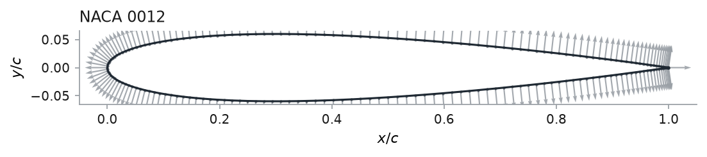

# Airfoil geometry

These formulas and point conventions define the supported airfoil sections. Generated NACA sections and imported coordinate files share one geometry interface.

## 4. Airfoil geometry

Implemented in `src/geometry.py`. A section is stored as a closed loop of
points, and everything downstream takes that loop without caring where it came
from — which is what makes an externally designed section a first-class input.

### The storage convention

Points form a **closed counter-clockwise loop with no repeated point**: index 0
is the trailing edge, the loop runs over the *upper* surface to the leading edge
and back along the *lower* surface, and the segment from the last point to point
0 closes it.

Counter-clockwise is not an arbitrary pick. For a curve traversed
counter-clockwise, the outward normal — pointing away from the body, into the
flow — is

```math
\hat{n} = \left(t_y,\ -t_x\right), \qquad
\hat{t} = \text{unit tangent in the direction of travel},
```

with no sign test anywhere. The mesh generator marches along $\hat n$ and the
wall flux orients itself with it, so one convention fixed once removes a sign
error from two places. It happens to coincide with the order XFOIL writes, and
it is the *reverse* of the legacy `nacageom.mat`, which ran trailing edge →
lower → leading edge → upper.

### The NACA four-digit family


For a section `MPXX` with thickness ratio $t = XX/100$, the half-thickness is

```math
y_t(x) = 5t\left(0.2969\sqrt{x} - 0.1260\,x - 0.3516\,x^2
         + 0.2843\,x^3 - a_4\,x^4\right),
```

with $a_4 = 0.1015$ for the original open trailing edge and $a_4 = 0.1036$ for
the closed one. **The default here is the closed form**, for two reasons:

* It is what the legacy geometry used. The points in `legacy/nacageom.mat` match
  $a_4 = 0.1036$ to $4\times10^{-17}$ and $a_4 = 0.1015$ only to
  $1.3\times10^{-3}$. `tests/test_geometry.py` pins this, so the port cannot
  drift off the geometry it is a port of.
* $y_t(1) = 0$ exactly, so the trailing edge is a single point and the O-grid
  has no blunt base to resolve.

Camber, for a non-zero first digit $m = M/100$ at position $p = P/10$:

```math
y_c(x) = \begin{cases}
  \dfrac{m}{p^2}\left(2px - x^2\right), & x \le p,\\[3mm]
  \dfrac{m}{(1-p)^2}\left(1 - 2p + 2px - x^2\right), & x > p,
\end{cases}
\qquad
\theta = \arctan \frac{dy_c}{dx},
```

and the surface is offset **normal to the camber line**,

```math
(x, y)_{\text{upper}} = \left(x - y_t \sin\theta,\ y_c + y_t \cos\theta\right),
\qquad
(x, y)_{\text{lower}} = \left(x + y_t \sin\theta,\ y_c - y_t \cos\theta\right),
```

rather than added vertically. The two agree to $O(\theta^2)$ and differ visibly
near the leading edge of a cambered section, which is exactly where the suction
peak is.



### Points from a file

`read_dat` takes both formats airfoil data actually comes in:

* **Selig** — one loop, trailing edge over the upper surface to the leading edge
  and back. This is what XFOIL's `SAVE` writes.
* **Lednicer** — the two surface point counts, then the upper surface from the
  leading edge, then the lower surface from the leading edge.

They are told apart rather than declared: a pair of numbers both greater than
one cannot be an airfoil coordinate, so a leading pair like `61. 61.` identifies
Lednicer. Either format, wound either way, is normalised to the convention above
— scaled to unit chord, leading edge at the origin, counter-clockwise, trailing
edge first.

### Resampling

A file typically carries 60–200 points and the mesh wants a specific count on a
specific distribution. Each side is resampled independently in its own arc
length, so the leading and trailing edge land exactly on the original points and
a symmetric section stays symmetric. The interpolation is a **Catmull–Rom cubic**
— the leading edge turns through 180° over a few points, and a linear reading of
it understates the thickness by about 1% of the thickness.

The default distribution is cosine on each side,

```math
s_k = \tfrac12\left(1 - \cos \frac{\pi k}{n}\right), \qquad k = 0,\ldots,n,
```

which packs points at the leading edge, where the curvature is, and at the
trailing edge, where the pressure recovery is steepest.


### The NACA five-digit family

The digits are `LPSTT`: $L$ sets the design lift coefficient as
$c_{\ell,\text{design}} = 0.15 L$, $P$ puts the camber crest at $x/c = P/20$,
$S$ selects a plain (0) or reflexed (1) camber line, and $TT$ is the thickness
in per cent. The thickness distribution is the **same quartic** as the
four-digit family; only the camber line differs, and it is a cubic forward of
the crest and straight behind it:

```math
y_c = \begin{cases}
  \dfrac{k_1}{6}\left(x^3 - 3mx^2 + m^2(3-m)x\right), & x \le m,\\[3mm]
  \dfrac{k_1 m^3}{6}\left(1 - x\right), & x > m .
\end{cases}
```

That is the point of the family: it puts the camber well forward, so the
aerodynamic centre moves far less with lift than a four-digit section's does. A
**reflexed** line ($S = 1$) adds a slight upward turn at the tail, which nulls
the pitching moment:

```math
y_c = \frac{k_1}{6}\begin{cases}
  (x-m)^3 - \frac{k_2}{k_1}(1-m)^3 x - m^3 x + m^3, & x \le m,\\[2mm]
  \frac{k_2}{k_1}(x-m)^3 - \frac{k_2}{k_1}(1-m)^3 x - m^3 x + m^3, & x > m .
\end{cases}
```

$m$ and $k_1$ are **not free parameters**. They are tabulated against $P$
(Abbott & von Doenhoff, Table 6.1), chosen so the crest lands at $P/20$ and the
design lift comes out right, and only five positions exist — four for a
reflexed line. A code naming any other is **refused rather than interpolated**:
an interpolated five-digit section is not a NACA section, and inventing one
silently would be worse than saying no.

NACA 23012 is the canonical one, and is what the test checks: 0.3 design lift,
crest at 15% chord, 12% thick. Measured from the generated surface, the crest
sits at $x/c = 0.1499$ with camber 0.01839, against the published 0.15 and
~0.0183.

The six-series and the modified four-digit sections have no closed form here;
read those from a coordinate file.
