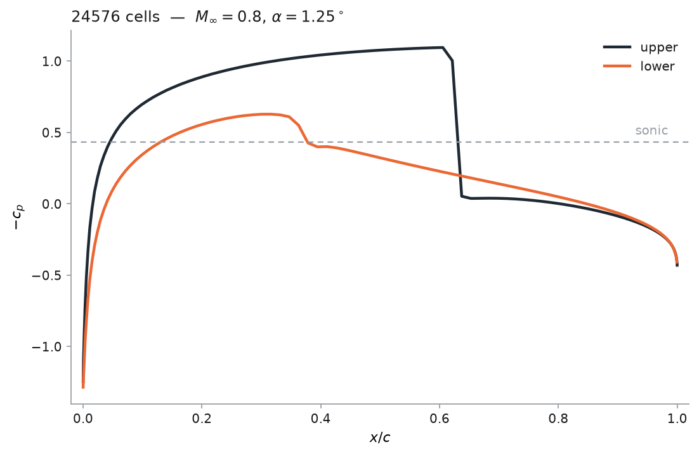
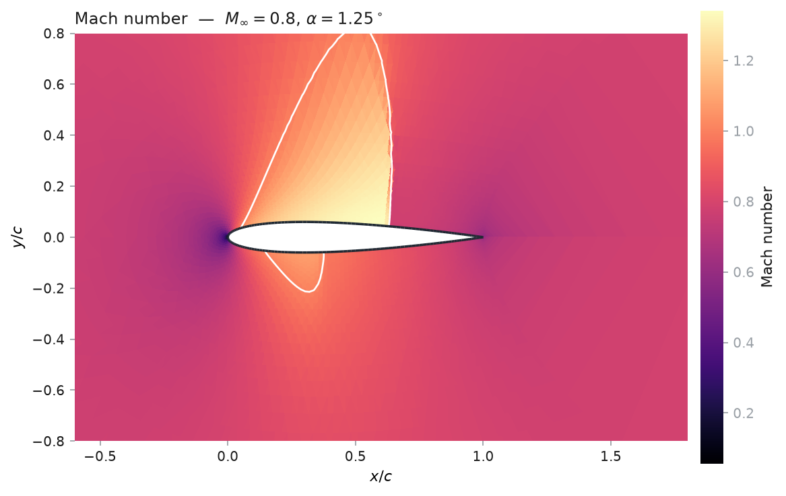
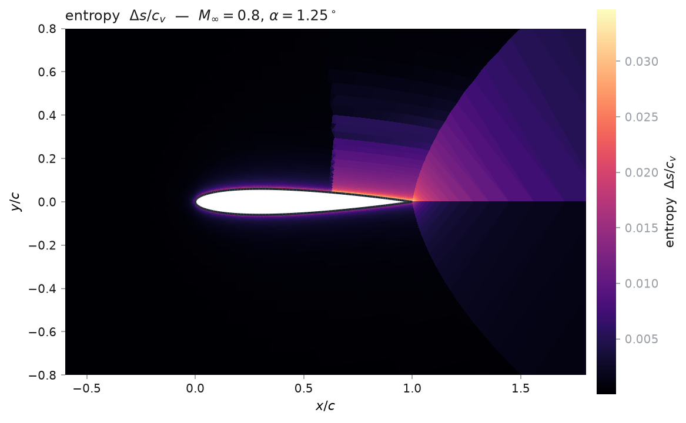

# Verification and troubleshooting

What this code has been checked against, what the numbers came out as, and what
to do when a run misbehaves. Everything on this page is **measured**, not
asserted; where a number is quoted, the mesh and the operating point are quoted
with it.

## Contents

- [What is checked automatically](#what-is-checked-automatically)
- [The adjoint gradient](#the-adjoint-gradient)
- [Free-stream preservation](#free-stream-preservation)
- [Lift against thin-airfoil theory](#lift-against-thin-airfoil-theory)
- [The transonic case](#the-transonic-case)
- [Spurious drag, and what first order costs](#spurious-drag-and-what-first-order-costs)
- [How far away the far field has to be](#how-far-away-the-far-field-has-to-be)
- [Stagnation-point overshoot](#stagnation-point-overshoot)
- [The legacy force formula, measured](#the-legacy-force-formula-measured)
- [Troubleshooting](#troubleshooting)

---

## What is checked automatically

`./fv2d.sh verify` runs the whole suite. The fast half takes about 15 seconds
and the slow half about a minute; neither needs a network or a service.

| Property | Where |
|---|---|
| Every flux is consistent, conservative, fully upwind when supersonic, and survives a near-vacuum | `tests/test_physics.py` |
| The far field reproduces the free stream exactly, at any angle of attack | `tests/test_physics.py` |
| **A uniform free stream stays uniform**, for both fluxes | `tests/test_solver.py` |
| The local time step equals the legacy's `CFL * d_h / s` | `tests/test_solver.py` |
| A symmetric section at zero incidence makes exactly zero lift | `tests/test_solver.py` |
| Lift is antisymmetric in angle of attack | `tests/test_solver.py` |
| The transonic case puts a shock on the upper surface | `tests/test_solver.py` |
| The discrete Gauss identity closes to round-off | `tests/test_mesh.py` |
| NACA 0012 reproduces `legacy/nacageom.mat` | `tests/test_geometry.py` |
| The compiled and the traced backends reproduce the vectorised residual | `tests/test_backends.py` |
| **The adjoint gradient matches a finite difference**, for a flow variable and a shape variable | `tests/test_sensitivity.py` |
| The traced free stream and the traced load integral equal the ones the solver reports | `tests/test_sensitivity.py` |
| A refined mesh still closes the discrete Gauss identity, and every leaf has at most one split edge | `tests/test_adapt.py` |
| **Repeated refinement does not produce slivers** — the smallest angle falls once and then holds | `tests/test_adapt.py` |
| Refining the wall makes the section rounder, towards its true area and not past it | `tests/test_adapt.py` |

## The adjoint gradient

The gradient is of the **discrete** problem, so the reference is a central
difference of this solver's own output — not of the exact Euler equations.
Measured on a 4096-cell O-grid around a NACA 2412 at $M = 0.5$ and
$2^\circ$, subcritical so that the objective is actually differentiable:

| $d c_\ell/d$ | adjoint | central difference | relative |
|---|---|---|---|
| `alpha` | $+1.18547016 \times 10^{-1}$ | $+1.18547020 \times 10^{-1}$ | $3 \times 10^{-8}$ |
| `mach` | $+2.42933313 \times 10^{-1}$ | $+2.42933500 \times 10^{-1}$ | $8 \times 10^{-7}$ |
| `camber` | $+1.21783132 \times 10^{1}$ | $+1.21783114 \times 10^{1}$ | $2 \times 10^{-7}$ |
| `camber_position` | $+1.73515107 \times 10^{-1}$ | $+1.73515127 \times 10^{-1}$ | $1 \times 10^{-7}$ |
| `thickness` | $+1.52774973 \times 10^{-1}$ | $+1.52774872 \times 10^{-1}$ | $7 \times 10^{-7}$ |

The two flow variables are exact adjoint derivatives; the three shape variables
take the hybrid route, with the mesh term finite-differenced at a frozen state,
which is why they sit an order of magnitude looser and still well inside what an
optimiser needs. Reproduce it with

```bash
./fv2d.sh sensitivity @subcritical naca=2412 ns=64 nr=32 R=10 h1=0.02 \
    tolerance=1e-10 max_iterations=60000 check=yes
```

**This will not agree at a transonic point**, and that is not a failure. The
shock jumps from one cell to the next rather than sliding, so the discrete
objective is only piecewise differentiable in the design variables and a small
step measures the jump rather than a derivative. →
[`workflows.md`](workflows.md#when-the-gradient-is-not-to-be-trusted)

## Free-stream preservation

The single most informative check, and the one worth running first after any
change to the fluxes, the metrics or the assembly.

A uniform free stream must give **exactly zero** residual in every cell that
does not touch the wall. Each interior face returns the exact flux by
consistency, so the cell sum collapses to $\mathbf{F}_\infty \cdot \sum_f
\hat{n}_f \ell_f$, which the discrete Gauss identity makes zero; the far-field
condition reproduces the free stream, so those faces behave the same. Only wall
cells differ, because a uniform flow does not satisfy a wall condition — which
is the entire reason the solution is not uniform.

Measured at $10^{-11}$ relative, for all four fluxes at $\alpha = 0$ and
$\alpha = 2.5^\circ$. Nothing else catches a sign error in a face normal or a
left/right pair swapped: both leave a uniform flow visibly decaying, and both
would otherwise show up only as a slightly wrong answer.

## Lift against thin-airfoil theory

The one closed form available. For a thin section at small incidence,
$c_\ell = 2\pi\alpha/\sqrt{1 - M_\infty^2}$.

NACA 0012 at $M_\infty = 0.5$, $\alpha = 2^\circ$, far field 15 chords:

| mesh | cells | $c_\ell$ | theory | error |
|---|---|---|---|---|
| 96 × 40 | 7 680 | 0.2464 | 0.2532 | −2.7% |

Within the 12% a 12%-thick section at finite Mach number should differ from a
*thin*-airfoil result, and converging the right way.

## The transonic case

The legacy operating point: NACA 0012, $M_\infty = 0.8$, $\alpha = 1.25^\circ$.
This is the standard inviscid test case, and it has a shock on the upper
surface.



192 × 64 O-grid, far field 20 chords, Roe flux, converged to $10^{-6}$ in
17 925 iterations — the run that drew the figure above, reproduced by
`python examples/06_postprocess.py`:

| | this code | published inviscid |
|---|---|---|
| upper-surface shock | $x/c = 0.629$ | 0.62–0.65 |
| lower-surface shock | $x/c \approx 0.38$ | ~0.35–0.40 |
| peak Mach number | 1.341 | ~1.35 |
| $c_\ell$ | 0.304 | ~0.35 |
| $c_d$ | 0.0327 | ~0.022 |

**The shock structure is right and the force coefficients are not yet.** Both
discrepancies have the same cause and it is not a mystery: the scheme is first
order, and the next section measures what that costs.



## Spurious drag, and what first order costs

D'Alembert's paradox says an inviscid, shock-free, steady flow produces
**exactly zero drag**. Anything the code reports at such a point is purely
numerical, which makes it a direct measure of the scheme's error.

NACA 0012 at $M_\infty = 0.5$, $\alpha = 0$, where $c_d$ must be 0:

| mesh | cells | $c_d$ (spurious) | entropy error |
|---|---|---|---|
| 64 × 32 | 4 096 | 0.0290 | 2.20e−4 |
| 96 × 40 | 7 680 | 0.0207 | 1.53e−4 |
| 144 × 56 | 16 128 | 0.0155 | 1.12e−4 |
| 192 × 72 | 27 648 | 0.0131 | 9.32e−5 |

It falls roughly as $h$ — first order, which is exactly what a piecewise-constant
reconstruction gives and no better.



The entropy field says where that error is made. Entropy is conserved along
streamlines in smooth flow, so everything bright here except the shock and the
wake behind it is the scheme rather than the physics — and the brightest part is
the **sheet along the entire wall**, which is numerical dissipation at the
surface acting as a boundary layer nobody asked for. That sheet is the spurious
drag in the table above, and it is why the loads converge so slowly.

Two consequences worth taking seriously:

* **Transonic drag is not usable at these resolutions.** The spurious drag at
  $\alpha = 0$ is 0.013, against a published wave drag of about 0.022 for the
  transonic case. The number the code reports is the sum of the two.
* **Lift is far less affected**, because it comes from a pressure difference
  that the numerical dissipation damages symmetrically. $c_\ell$ is within a
  few per cent where $c_d$ is out by half.

This is the strongest argument for a higher-order reconstruction, which was
decided in increment 3 and deliberately deferred ([`roadmap.md`](roadmap.md)).
It is also why the lift tests carry tight tolerances and there is no drag test.
Adaptive refinement recovers part of it — [measured in
`adaptation.md`](adaptation.md#does-it-pay) — but only part, and at a cost in
iterations.

## How far away the far field has to be

The legacy used 50 chords because it imposed the whole free-stream state at the
boundary, which reflects. This code uses a characteristic condition, so the
question is open — and it is a measurement, not a guess.

NACA 0012 at $M_\infty = 0.5$, $\alpha = 2^\circ$, 96 × 40:

| far field | $c_\ell$ | $c_d$ | iterations |
|---|---|---|---|
| 8 c | 0.24327 | 0.02308 | 6 201 |
| 12 c | 0.24565 | 0.02339 | 5 872 |
| **20 c** | **0.24711** | **0.02380** | **5 462** |
| 30 c | 0.24743 | 0.02413 | 5 189 |
| 50 c | 0.24722 | 0.02456 | 5 044 |

$c_\ell$ moves by **1.7% across the whole range**, and the default 20 chords is
within **0.05%** of 50. Even 12 chords is within 0.6%. The provisional default
is therefore confirmed: the domain can be 2.5× smaller than the legacy's, and a
smaller domain also converges in *fewer* iterations because the far field is
nearer the body in cell count as well as in distance.

## Stagnation-point overshoot

A known first-order artifact, recorded because it looks alarming in a $c_p$
plot and is not a bug.

At the stagnation point the computed static pressure **exceeds the free-stream
total pressure**, which is physically impossible:

| mesh | $p_{\max}/p_{t\infty}$ | $c_p$ overshoot |
|---|---|---|
| 96 × 40 | 1.039 | +25% |
| 192 × 72 | 1.016 | +10% |

It halves with refinement, so it is discretisation error rather than a
formulation defect — and the wall condition is not the cause, since the raw
interior cell pressure overshoots by the same amount. The reason it looks so
much worse in $c_p$ than in $p$ is that $c_p$ subtracts a large baseline: a 4%
pressure error becomes a 25% $c_p$ error at a point where $c_p \approx 1$.

## The legacy force formula, measured

`legacy/post_calc.m` integrates the surface pressure with `sign(n_x)` and
`sign(n_y)` in place of the normal components, and applies $\sin\alpha$ and
$\cos\alpha$ to two separate integrals rather than rotating the force vector.
[`theory.md`](theory.md#forces-and-coefficients) has the derivation. The size of
the error, at $M_\infty = 0.5$, $\alpha = 2^\circ$:

| | $c_\ell$ | $c_d$ |
|---|---|---|
| correct | +0.2464 | +0.0236 |
| legacy formula | +0.2567 | +0.1465 |
| error | +4% | **+520%** |

Lift survives because the error partly cancels between the two surfaces. Drag
does not: it is six times too large, which would make any drag-based conclusion
from the legacy code meaningless. `legacy_forces` reproduces the old expression
so this stays checkable rather than remembered.

## Troubleshooting

**The march diverges.** The solver says so and stops rather than returning
numbers. In order of likelihood: the CFL is too high (the default 0.9 is near
the explicit limit, so try 0.5); or the mesh has a bad cell, which
`./fv2d.sh mesh` will report before you ever solve.

**It converges to the wrong answer.** Check free-stream preservation first —
`pytest tests/test_solver.py -k free_stream`. If that passes, the assembly and
the boundary conditions are sound and the problem is resolution.

**It will not converge but does not diverge either.** The residual falls a few
orders and then sits there. That is a limit cycle; the AUSM-family schemes that
did it reproducibly have been removed ([`riemann_fluxes.md`](riemann_fluxes.md)),
so with Roe or HLLC suspect a mesh with a sliver cell, or try the other flux.

**The mesh builder refuses.** The message names the four numbers that would fix
it. See [`usage.md`](usage.md#meshing-it).

**The drag looks far too large.** It probably is; see
[spurious drag](#spurious-drag-and-what-first-order-costs) above.
