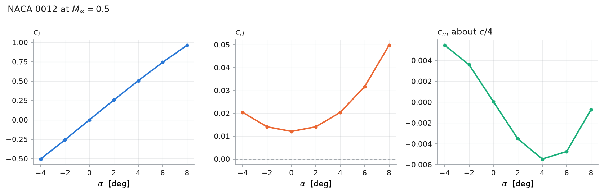

# Workflows

The three things this code is actually *for*, beyond solving one point: sweeping
an operating condition, taking exact design gradients, and letting an optimiser
drive the shape with them.

Every snippet here is a runnable script in [`../examples/`](../examples/), and
the numbers quoted are what those scripts printed on the machine they were
written on.

## Contents

- [Sweeping the angle of attack](#sweeping-the-angle-of-attack)
- [Exact design gradients](#exact-design-gradients)
  - [Why an adjoint, and not `jax.grad`](#why-an-adjoint-and-not-jaxgrad)
  - [Taking one](#taking-one)
  - [What it costs](#what-it-costs)
  - [The shape variables, and the one compromise](#the-shape-variables-and-the-one-compromise)
  - [Checking a gradient](#checking-a-gradient)
- [Shape optimisation](#shape-optimisation)
- [When the gradient is not to be trusted](#when-the-gradient-is-not-to-be-trusted)

---

## Sweeping the angle of attack

Incidence enters this formulation through the free-stream **direction** alone.
The mesh does not rotate with it, so a sweep costs one mesh — not one per point —
and that is the single largest saving available here. Build the case once and
reuse it:

```python
from src import Discretization, FlowConditions, SolverOptions, build_case, naca4
from src.post.postprocess import forces

mesh = Discretization(n_surface=128, n_radial=48, far_field_radius=20.0)
case = build_case(naca4("2412", mesh.n_surface), mesh)
options = SolverOptions(tolerance=1e-7, print_interval=0)

state = None
for alpha in (-4.0, -2.0, 0.0, 2.0, 4.0, 6.0, 8.0):
    result = case.solve(FlowConditions(mach=0.5, alpha_deg=alpha), options, state=state)
    state = result.state  # warm start: the next angle begins here
    print(alpha, forces(result).cl)
```

Two things are doing the work. `case` holds the mesh and every metric, so no
geometry is rebuilt. And `state=state` starts each solve from the previous
angle's converged field, which is a flow already close to the answer.

Measured on the mesh above — 12 288 cells, a NACA 2412 at $M = 0.5$ — seven
angles converge to $10^{-7}$ in **30 s in total**, about 4.3 s each.



*Three panels rather than three curves on one axis: $c_\ell$, $c_d$ and $c_m$
differ by an order of magnitude, and a shared axis flattens two of them into the
baseline. From the launcher, `./fv2d.sh sweep @subcritical alphas=-4:8:2
figure=polar.png`; from Python, `src.post.plotting.plot_polar`.*

The curve is also the first check worth making on a new mesh. Thin-aerofoil
theory with the Prandtl–Glauert factor gives a lift slope of
$2\pi/\sqrt{1 - M^2} = 7.26$ per radian at $M = 0.5$; the fit over
$|\alpha| \le 4^\circ$ gives **7.12**, or 98% of it, and the zero-lift incidence
comes out at $-2.09^\circ$, negative because the section is cambered.

→ [`../examples/02_alpha_sweep.py`](../examples/02_alpha_sweep.py) for the
numbers, [`../examples/06_postprocess.py`](../examples/06_postprocess.py) for
the figure.

## Exact design gradients

`src/sensitivity.py` differentiates a converged solution with respect to the
angle of attack, the Mach number, and the shape. It needs JAX:

```bash
./fv2d.sh install          # or: pip install -e ".[jax]"
```

### Why an adjoint, and not `jax.grad`

Differentiating the march itself is the obvious thing and the wrong thing. It
tapes every iteration — thousands of copies of the residual graph — and what it
returns is the derivative of the *iteration history*, which depends on where the
march started and when it was stopped.

The converged state is instead defined implicitly by $R(\vec U, \vec a) = 0$, and
the implicit function theorem gives the derivative of the **answer**:

$$
\frac{dJ}{d\vec a}
  = \frac{\partial J}{\partial \vec a}
  - \vec\lambda^{T}\frac{\partial R}{\partial \vec a},
\qquad
\left(\frac{\partial R}{\partial \vec U}\right)^{T}\!\vec\lambda
  = \left(\frac{\partial J}{\partial \vec U}\right)^{T}.
$$

Only the converged state appears. Both Jacobian actions come from `jax.vjp` on
the residual, so no matrix is ever assembled, and — the part worth internalising
— **the adjoint follows the scheme**. It differentiates whatever
`src/spatial/assembly.py` computes, so changing the flux, or adding a higher-order
reconstruction later, changes the gradient with nothing to re-derive by hand.

The adjoint system itself is marched in pseudo-time, exactly like the flow:

$$
\frac{d\vec\lambda}{d\tau} = -\frac{1}{A}
  \left[\left(\frac{\partial R}{\partial \vec U}\right)^{T}\vec\lambda
        - \left(\frac{\partial J}{\partial \vec U}\right)^{T}\right].
$$

The mass matrix is the cell area — a positive diagonal — so
$A^{-1}(\partial R/\partial \vec U)^{T}$ has the **same spectrum** as the forward
operator. The forward solver's local time step therefore carries over unchanged,
which is what makes the adjoint as robust as the march and removes any need for a
preconditioner.

### Taking one

```python
from src.sensitivity import differentiable_case

case = differentiable_case(
    "2412",
    n_surface=64,
    n_radial=32,
    far_field_radius=10.0,
    first_cell_height=0.02,
    mach=0.5,
    alpha=2.0,
    tolerance=1e-10,
    print_interval=0,
)
cl, gradient = case.value_and_gradient("cl")
```

```
cl = +0.485223
d(cl)/d alpha            = +1.185470e-01   per degree
d(cl)/d mach             = +2.429333e-01
d(cl)/d camber           = +1.217831e+01
d(cl)/d camber_position  = +1.735151e-01
d(cl)/d thickness        = +1.527750e-01
```

| | |
|---|---|
| objectives | `cl`, `cd`, `cm`, `efficiency` (= $c_\ell/c_d$) |
| flow variables | `alpha` (degrees), `mach` |
| shape variables | `camber`, `camber_position`, `thickness` — the four-digit $m$, $p$, $t$ |

`value_and_gradient("cd", ("alpha",))` restricts the variables; `case.variables`
reports what is available, which is the flow pair alone when the section did not
come from a four-digit code.

Inside a design loop there is no code to write, so build the case from the
parameters as numbers:

```python
from src.sensitivity import four_digit_case

case = four_digit_case(0.0213, 0.37, 0.12, mach=0.5, alpha=1.0)
```

This matters more than it looks. `"0012"` cannot be perturbed by $10^{-5}$, and
recovering $(m, p, t)$ by *sampling* a surface is not accurate enough to
differentiate: a four-digit camber line is flat near its crest, so a fit returns
$p = 0.441$ for a NACA 2412 whose true crest is at $0.4$. The parameters are
therefore parsed from the digits when there is a code, and shape derivatives are
simply **unavailable** for a section read from a file — inventing parameters for
it would be worse than saying so.

### What it costs

One adjoint solve, whatever the number of design variables. That is the whole
claim, and it is worth being precise about what it buys *here*:

| | 64×32 mesh, 4096 cells |
|---|---|
| forward solve (Numba) | 2.2 s |
| adjoint solve + all five gradients (JAX) | ~27 s, flat in the number of variables |
| central finite difference, five variables | 14.4 s, about 2.9 s **each** |

So on a mesh this small the adjoint is not the cheaper route — it breaks even at
around nine variables. The reason is not the method: the forward solver is fused
Numba and the adjoint march runs in JAX, which is several times slower per sweep,
and a few of those seconds are JAX compiling the traced residual once.

The scaling is what matters. The adjoint column does not move as variables are
added; the finite-difference column grows linearly. A handful of variables does
not need an adjoint. A twenty-variable shape cannot do without one.

### The shape variables, and the one compromise

`alpha` and `mach` enter through **one vector** — the free-stream state — and not
through the mesh. Their derivatives are exact with no geometric differentiation
whatever, which is why they came first.

The shape variables move the mesh, and making the whole pipeline traceable would
mean a differentiable surface generator, a differentiable marcher including the
bisection that solves for the growth ratio, and a traced copy of every metric the
residual reads. That is a large refactor for a small term, so the standard hybrid
route is taken instead:

$$
\frac{dJ}{da} \approx
  \underbrace{\frac{\partial J}{\partial a}\bigg|_{\vec U}}_{\text{finite difference}}
  - \vec\lambda^{T}
  \underbrace{\frac{\partial R}{\partial a}\bigg|_{\vec U}}_{\text{finite difference}}
$$

**The expensive part stays exact.** $\vec\lambda$ is the adjoint, solved once,
and it is what the flow's response to the shape costs. The two
finite-differenced terms are evaluated at a **frozen state**: no iteration, no
convergence tolerance, just rebuild the mesh and evaluate a residual twice. They
are smooth and well conditioned, which is what a finite difference is good at and
what a converged flow solve is not. All three shape derivatives together add
**0.3 s** to the table above.

### Checking a gradient

```python
from src.sensitivity import check_gradient

for name, row in check_gradient(case, "cl", ("alpha", "thickness")).items():
    print(name, row["adjoint"], row["finite_difference"], row["relative_error"])
```

Agreement at a shock-free point, measured on the 64×32 mesh:

| variable | adjoint | finite difference | relative |
|---|---|---|---|
| `alpha` | $+1.18547016 \times 10^{-1}$ | $+1.18547020 \times 10^{-1}$ | $3 \times 10^{-8}$ |
| `mach` | $+2.42933313 \times 10^{-1}$ | $+2.42933500 \times 10^{-1}$ | $8 \times 10^{-7}$ |
| `camber` | $+1.21783132 \times 10^{1}$ | $+1.21783114 \times 10^{1}$ | $2 \times 10^{-7}$ |
| `camber_position` | $+1.73515107 \times 10^{-1}$ | $+1.73515127 \times 10^{-1}$ | $1 \times 10^{-7}$ |
| `thickness` | $+1.52774973 \times 10^{-1}$ | $+1.52774872 \times 10^{-1}$ | $7 \times 10^{-7}$ |

`check_gradient` **reports** rather than asserts, deliberately — see the last
section for when the two should be expected to differ.

→ [`../examples/03_sensitivity.py`](../examples/03_sensitivity.py)

## Shape optimisation

With a gradient, any gradient-based optimiser will do; nothing in `src/` has to
know about it. SciPy's L-BFGS-B, given `jac=True`:

```python
import numpy as np
from scipy.optimize import minimize
from src.sensitivity import four_digit_case

TARGET, CREST, WEIGHT = 0.60, 0.4, 0.5


def objective(x):
    case = four_digit_case(
        x[0],
        x[1],
        0.12,
        n_surface=48,
        n_radial=24,
        far_field_radius=10.0,
        first_cell_height=0.02,
        mach=0.5,
        alpha=0.0,
        tolerance=1e-9,
        print_interval=0,
    )
    cl, g = case.value_and_gradient("cl", ("camber", "camber_position"))
    offset = (x[1] - CREST) / CREST
    J = (cl - TARGET) ** 2 + WEIGHT * offset**2
    return J, np.array(
        [
            2 * (cl - TARGET) * g["camber"],
            2 * (cl - TARGET) * g["camber_position"] + 2 * WEIGHT * offset / CREST,
        ]
    )


found = minimize(
    objective,
    np.array([0.02, 0.30]),
    jac=True,
    method="L-BFGS-B",
    bounds=[(0.005, 0.08), (0.15, 0.60)],
)
```

Which camber line gives $c_\ell = 0.6$ at zero incidence? From a NACA 2312,
**eight** flow solves and eight adjoint solves — 73 s — give $m = 0.0515$ at a
crest of $0.4000$, hitting the target to five decimal places. Rounded to digits,
a NACA 5412.

The regulariser is not decoration. A target lift in two variables is
**underdetermined** — many camber lines give the same $c_\ell$ — and an optimiser
handed an underdetermined problem wanders along the valley floor until it runs
out of iterations. The second term picks the member of that family nearest the
familiar crest position, which is a design decision made in the open rather than
an accident of where the search started.

→ [`../examples/04_optimise.py`](../examples/04_optimise.py)

## When the gradient is not to be trusted

The gradient is of the **discrete** problem. It matches a finite difference of
*this solver's* output, not of the exact Euler equations — which is precisely
what a gradient-based optimiser needs, since the optimiser is minimising this
solver's output too. Three things to watch:

**A shock breaks differentiability.** The shock jumps from one cell to the next
rather than sliding, so the discrete objective is only piecewise differentiable
in the design variables. The gradient stays well defined and useful, but a
finite-difference check at a transonic point disagrees at the level of that jump,
and a step smaller than one cell's worth of shock movement measures noise rather
than a derivative. This is why the verification above is done subcritically, and
why `check_gradient` reports instead of asserting.

**The march must have converged.** A gradient taken from a stalled state is the
derivative of nothing in particular. `DifferentiableCase.solve` raises rather
than hand one back, and the forward tolerance should be tighter than for
reporting loads — $10^{-9}$ or $10^{-10}$, not $10^{-6}$.

**The flow is inviscid and first order.** The drag in particular is dominated by
the scheme at these resolutions: [`verification.md`](verification.md) measures
0.0131 of spurious drag at zero incidence on the finest mesh there. A gradient of
`cd` is therefore a real derivative of a quantity that is partly numerical, and
`efficiency` ($c_\ell/c_d$) inherits that. Lift and moment are on much firmer
ground, which is why the examples optimise lift.
